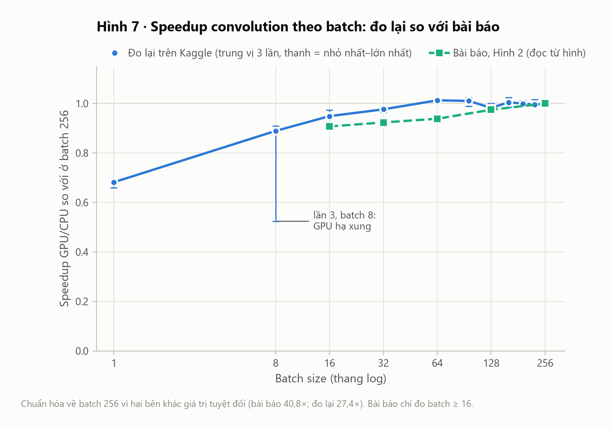
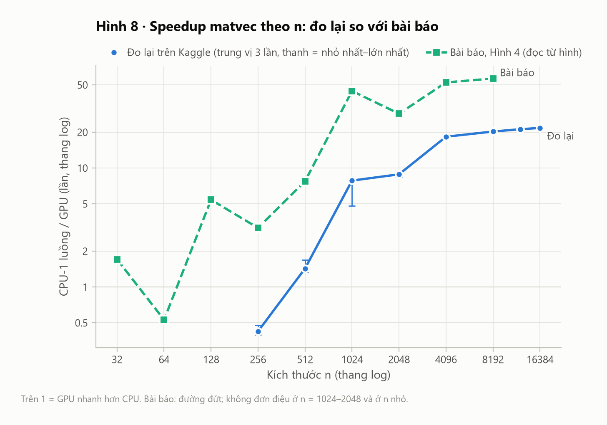
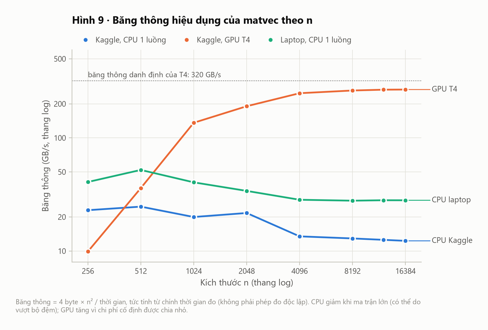

# Phân tích kết quả và đối chiếu với bài báo (giai đoạn 5)

Số liệu: `results/analysis/tables.md` (sinh bởi `code/analyze.py`) từ 3 lần chạy Kaggle và 3 lần chạy laptop; số liệu bài báo đọc từ
**Hình 1–4 trong PDF**, lưu ở `results/paper_digitized.csv` (cách đọc và sai số ghi trong file). Dùng **trung vị** 3 lần chạy cho speedup theo batch.

**Đính chính so với README và các báo cáo trước:** trước đây tôi chỉ đọc phần chữ của bài. Nhìn vào hình thì thấy (1) Hình 1 có trục "Time (ms)" nên
độ dốc **đúng là ms/ảnh** (đọc ra 6,32 so với 6,45 trong phần chữ); (2) bài báo đo batch 16, 32, 64, 128, 256; (3) Hình 3 **có tiêu đề "matrix
vector multiplication"** nhưng chú thích ghi "matrix-matrix"; ngoài ra số tuyệt đối của FC gợi ý có thể là nhân nhiều vector (mục 3).

## 1. Đối chiếu từng kết luận của bài báo

| # | Kết luận của bài báo (phần 3.2) | Đo lại | Kết luận |
|---|---|---|---|
| 1 | Thời gian conv của CPU tuyến tính theo batch | R² ≥ 0,9996 ở cả 3 lần (Kaggle, 1 luồng); laptop 1 luồng ≥ 0,9997, 8 luồng ≥ 0,998 | **Lặp lại được** |
| 2 | Thời gian conv của GPU tuyến tính theo batch, vì CPU giữ luồng điều khiển | R² ≥ 0,9994. Nhưng cách batched (gộp cả batch, không có vòng lặp từng ảnh) cũng tuyến tính (R² ≥ 0,997) | Tuyến tính: lặp lại được. **Lý do "CPU điều khiển" thì không suy ra được từ tính tuyến tính** (mục 2) |
| 3 | GPU nhanh hơn CPU khoảng 40 lần (conv) | 27,3 / 27,4 / 28,6 (trung bình 27,8) | Cùng bậc, **không lặp lại con số** |
| 4 | Batch lớn hơn cho speedup cao hơn | Tăng mạnh từ batch 1 đến 16–32 (18,7× → 27×), rồi gần như phẳng. Từ 16 đến 256: khoảng +3% (trung vị; từng lần +3% đến +9%) | **Một phần**: bài báo tăng +10% trong cùng khoảng (37,0× → 40,8×); xem Hình 7 |
| 5 | FC tăng theo O(n²) trên CPU và GPU | CPU: 2,0–2,2 (tùy khoảng khớp). GPU: 1,94 (n ≥ 4096) hoặc 1,75 (n ≥ 1024) | CPU: **lặp lại được**. GPU: xấp xỉ |
| 6 | FC: hệ số chênh cũng khoảng 40 lần | 18,3× (n = 4096), 20,3× (n = 8192), 21,7× (n = 16384); bài báo ở n = 4096–8192: 52,5–56,6× | **Không lặp lại con số** (nhỏ hơn khoảng 2,8 lần ở cùng n); nhưng **có thể không cùng phép** (mục 3) |
| 7 | Ma trận lớn hơn cho speedup FC cao hơn | Đơn điệu tăng: 0,42× → 21,7×. Ở bài báo không đơn điệu: n = 1024 → 2048 speedup **giảm** từ 44 xuống 29 (Hình 4) | **Lặp lại được về xu hướng** (kết luận của bài đúng với dữ liệu của chúng tôi hơn là với chính Hình 4 của họ) |

## 2. Convolution

**Mô hình hai tham số.** Thời gian GPU cho một batch B khớp `t(B) = a + b·B` với a = 22,7 / 23,7 / 30,0 µs (chi phí cố định mỗi lần gọi: khởi chạy kernel
và đồng bộ) và b = 64,8 / 68,8 / 71,6 µs/ảnh. Mô hình này tái tạo **toàn bộ** đường speedup theo batch với sai lệch tối đa 4–7%. Hệ quả: speedup
thấp ở batch nhỏ là do a chưa được chia cho nhiều ảnh, và phẳng ở batch lớn vì a trở nên nhỏ so với b·B. Đây là lý do trong kế hoạch cho việc "batch
nhỏ thì GPU chưa được dùng hết" và nó được xác nhận bằng số (trừ điểm batch 8 của lần 3, GPU bị hạ xung xuống 795 MHz).

**Vì sao tỷ lệ là 27,8 chứ không phải 40?** Tốc độ conv (FLOP/s) của bài báo: CPU 10,5 và GPU 423 GFLOP/s; của chúng tôi: CPU-1 luồng 36,2 và
GPU 1001 GFLOP/s. Tức CPU nhanh lên **3,4×**, GPU chỉ **2,4×**; tỷ lệ giảm vì CPU tiến bộ nhiều hơn GPU trong bài toán này. Đây **chỉ là phép tách số học**
(40,3 / 27,8 ≈ 3,4 / 2,4), không phải giải thích: khác nhau cùng lúc về đời phần cứng, thư viện (Caffe so với PyTorch + MKL/cuBLAS), công suất GPU
(T4 bị giới hạn khoảng 70 W) và cách cài đặt. Với `nn.Conv2d` trên cả hai thiết bị, tỷ lệ còn 14× (xem README), tức con số "bao nhiêu lần" phụ thuộc
mạnh vào cách cài đặt: trên cùng phần cứng đã đổi từ 27,8× xuống 14×.

**Vòng lặp từng ảnh có tốn gì không?** Theo thời gian, cách batched không nhanh hơn (trung vị 74,1 so với 69,2 µs/ảnh). Nhưng xung nhịp GPU khi chạy batched thấp hơn
(1042 so với 1377 MHz), nhiều khả năng vì công suất cả hai đều quanh 65–69 W, sát trần 70 W của T4 (không có bằng chứng trực tiếp). Tính theo **chu kỳ**, batched tốn 77,2 nghìn chu kỳ/ảnh so với 95,3 nghìn của
kiểu Caffe, tức **ít hơn 19%**; `conv2d` chỉ 45,2 nghìn (ít hơn 53%). Vậy theo chu kỳ, gộp batch hiệu quả hơn (gồm cả việc bỏ vòng lặp và dùng ma trận lớn
hơn), nhưng mức chênh 19% **không lớn** và **không thấy được ở thời gian đồng hồ** trên T4 ở 70 W. Về lý do "CPU giữ luồng điều khiển": thời gian CPU phát lệnh khoảng 42 µs/ảnh, bằng khoảng 63% thời gian GPU
(khoảng 65 µs/ảnh); GPU là nút nghẽn, nhưng **nếu GPU nhanh hơn 1,5× thì CPU phát lệnh sẽ thành trần mới (khoảng 42 µs/ảnh, tối đa khoảng 45× so với CPU-1 luồng)**. Bài báo
suy ra "O(n) vì CPU điều khiển", nhưng **tính tuyến tính không chứng minh nguyên nhân đó**: cách batched, không có vòng lặp từng ảnh, cũng tuyến tính, vì khối lượng công việc vốn tỷ lệ với B.

**GPU dùng được bao nhiêu phần trăm?** Trần FP32 ở đúng xung nhịp đo được (2560 nhân × 2 FLOP/chu kỳ): GEMM đạt **84–97%** trần ở xung nhịp đo được (số FLOP bám theo xung nhịp, tức bị giới hạn
bởi tính toán); conv kiểu Caffe chỉ **14%**, batched 17%, conv2d 30%. Như vậy conv chưa dùng hết năng lực tính toán như GEMM; đo riêng từng bước
(`results/analysis/mem_tables.md` mục 5, batch 256 trên GPU): im2col tốn 43,6 nghìn chu kỳ/ảnh (46%) và GEMM 51,4 nghìn (54%), cộng lại 95,0 khớp với conv 95,5 nghìn. Riêng GEMM chỉ đạt **26%** trần FP32 (ma trận 96×121 và 121×2916 nhỏ), nên 14% của conv đến từ cả hai: gần một nửa số chu kỳ dành cho im2col và GEMM nhỏ kém hiệu quả. Chu kỳ mỗi ảnh của conv (95,5 nghìn) trùng với lần chạy chính thức ngày 22/11 (95,3 nghìn). Trên CPU 1 luồng: im2col 804 µs (46%), GEMM 769 µs (44%), phần còn lại (vòng lặp) khoảng 10%.

## 3. Matvec (FC)

- **Vì sao speedup tăng theo n?** Hai hiệu ứng cùng chiều: (1) GPU có chi phí cố định khoảng 25 µs: ở n = 256 cả phép chỉ mất khoảng 26 µs, nên GPU chậm hơn CPU (0,42×), phần chi phí này chỉ được chia nhỏ khi n lớn; (2) CPU **mất băng thông khi ma trận lớn**: 20–25 GB/s (n ≤ 2048) còn 12,3–13,5 GB/s (n ≥ 4096) trên Kaggle (do ma trận vượt bộ đệm L3 38,5 MB của máy ảo Kaggle: n = 2048 là 16 MB, n = 4096 là 64 MB; các kernel độc lập sum, dot, triad cũng giảm giống vậy), trong khi GPU đi từ 9,9 lên 267 GB/s.
- **GPU có bị giới hạn bởi băng thông bộ nhớ không?** Ở n = 8192–16384, GB/s của GPU giữ **262–268** trong khi xung nhịp SM của khoảng đo thay đổi từ 630 đến 1590 MHz (mỗi điểm 3 lần chạy; xung nhịp bộ nhớ trong các khoảng đo này đều là 5000 MHz). Nếu bị giới hạn ở tính toán thì GB/s phải thay đổi theo xung nhịp SM. Đây là bằng chứng **không phụ thuộc** vào việc GB/s được tính từ thời gian (kết luận cũ của tôi về tỷ lệ băng thông bị vòng tròn; xem README). Mỗi khoảng đo chỉ có 1–3 mẫu xung nhịp (lấy mẫu 20 ms). Trần: 267 GB/s = 84% băng thông danh định 320 GB/s. Kiểm chứng độc lập (PREDICTIONS.md D2, 3 lần chạy): `sum` và `dot` đạt 253–272 GB/s ở n ≥ 8192, còn matvec 262–268 GB/s, tức **97–99%** của phép đọc tốt nhất.
- **CPU có bị giới hạn bởi băng thông không?** Có, trên Kaggle (PREDICTIONS.md D1 và D3, đo độc lập): băng thông đọc tốt nhất (`sum`, `dot`) của 1 luồng là 14,3 / 13,5 / 13,6 GB/s ở n = 4096 / 8192 / 16384, còn matvec là 14,2 / 13,4 / 12,5 GB/s, tức 92–100%. Với 2 luồng: 27,2 / 25,8 / 26,1 và matvec 27,7 / 25,7 / 24,0 (92–102%). Một luồng chưa lấp đầy băng thông bộ nhớ của máy (2 luồng gấp 1,9 lần).
- **"Speedup FC ≈ tỷ lệ băng thông" (dự đoán trong kế hoạch)** nay **phù hợp trên Kaggle**: tỷ lệ băng thông đọc GPU/CPU-1 luồng đo độc lập là 18,1 / 20,0 / 20,0 (n = 4096 / 8192 / 16384), tỷ lệ matvec trong cùng lần đo là 17,6 / 19,5 / 21,4, lệch tối đa 7%. Ngược lại với nhiều vector (n×n)·(n×B) tỷ lệ tăng theo B (35× ở B = 64, 45× ở B = 128), tức bị giới hạn bởi tính toán; hai chế độ này phân biệt được. Kết luận này chỉ kiểm chứng trên một máy Kaggle.
- **Số tuyệt đối của FC trong bài báo không khớp với matvec thường.** Ở n = 8192, bài báo: CPU 967 ms (14,4 ns/phần tử, tương đương 0,28 GB/s), GPU khoảng 17–19 ms (14–16 GB/s, K520 danh định 160 GB/s). Nếu là một matvec đọc mỗi phần tử một lần thì CPU chậm hơn khả năng hơn một bậc (cùng CPU đó đạt 10,5 GFLOP/s ở conv). **Một giả thuyết phù hợp với số liệu (chưa kiểm chứng):** họ đã nhân (n×n)·(n×B) với B khoảng 64–78 vector (như chú thích Hình 3 ghi "matrix-matrix"): khi đó CPU đạt khoảng 8,6–11 GFLOP/s, gần với conv (10,5), và GPU đạt 490–600 GFLOP/s ở n ≥ 4096 (21–26% trần của K520; 246–292 ở n = 2048 do tỷ lệ Hình 4 tụt; xem mục 5b của `tables.md`). Cũng không loại trừ việc họ không dùng BLAS tối ưu. **Kết quả thử trên Kaggle (D4, 3 lần chạy, n = 8192):** tỷ lệ CPU-1 luồng/GPU là 19× (B = 1), 26× (16), 35× (64) và 45× (128; từng lần 34,6–51,1), tăng theo B và cùng bậc với 40–57× của bài khi B ≥ 64. Điều này **phù hợp** với giả thuyết nhưng **không xác nhận**: GPU T4 bị hạ xung nên con số dao động (lần 2, B = 128 ở 742 MHz), và chúng tôi không biết B của bài. Về tuyệt đối, CPU của bài (967 ms) vẫn chậm hơn CPU-1 luồng của chúng tôi (97 ms ở B = 64) khoảng 10 lần. Hệ quả: **so sánh 21,7× của chúng tôi với 40× của bài có thể so hai phép khác nhau**, nên không coi tỷ lệ đó là tỷ lệ phần cứng. Tham khảo (chỉ để so độ lớn): CPU-1 luồng đo lại của chúng tôi nhanh hơn CPU bài báo 46× (20,8 so với 967 ms) và GPU khoảng 17×.

## 4. Song song trên CPU (Amdahl, hiệu suất)

Theo Ch1 (định luật Amdahl: speedup = 1 / (S + P/N)) và Ch7 (E = S/p, chi phí p·Tp). Giải Amdahl cho phần nối tiếp f: f = (1/S − 1/p) / (1 − 1/p).

| Phép tính | Kaggle p=2: S / E / f | Laptop p=8: S / E / f |
|---|---|---|
| Conv kiểu Caffe | 1,49 / 74% / 0,35 | 3,80 / 48% / 0,16 |
| Conv batched | 1,74 / 87% / 0,15 | 3,19 / 40% / 0,22 |
| conv2d (oneDNN) | 1,93 / 97% / 0,04 | 3,06 / 38% / 0,23 |
| GEMM n=4096 | 1,91 / 95% / 0,05 | 4,50 / 56% / 0,11 |
| Matvec n=16384 | 1,91 / 95% / 0,05 | 1,03 / 13% / 0,97 |

Hiệu suất giảm khi số luồng tăng (đúng hướng của Ch7: cùng kích thước bài toán, hiệu suất giảm theo p). Con số f **phụ thuộc máy** (conv: 0,35 trên Kaggle, 0,16 trên
laptop) nên không phải "phần nối tiếp của thuật toán" mà gộp cả giới hạn phần cứng và phần mềm. Matvec trên laptop không tăng tốc gì với 8 luồng (1,03×; từng lần
1,12 / 1,00 / 0,96) trong khi trên Kaggle với 2 luồng là 1,91×: chưa biết vì sao (có thể do hệ điều hành/thư viện; chưa kiểm chứng).

## 5. Đối chiếu với các hướng giải thích đã ghi trong kế hoạch

README mới ghi bốn dự đoán chính; kế hoạch (ghi trong trò chuyện trước khi chạy, không có trong git) còn các hướng giải thích sau, tôi bổ sung ở đây **kể cả phần sai**:

| Dự đoán trong kế hoạch | Kết quả |
|---|---|
| "Vòng lặp tuần tự từng ảnh; so với batched sẽ thấy rõ phần lợi ích bị mất" | Một phần: theo chu kỳ batched ít hơn 19%, nhưng **theo thời gian không nhanh hơn** (do GPU bị giới hạn công suất). O(n) không phải bằng chứng cho vòng lặp |
| "Batch nhỏ: chi phí khởi chạy kernel nên GPU chưa dùng hết" | Đúng: chi phí cố định 23–30 µs mỗi lần gọi, mô hình khớp speedup trong 4–7% |
| "Conv compute-bound, matvec memory-bound; speedup FC ≈ tỷ lệ băng thông" | Matvec CPU và GPU: giới hạn bởi băng thông (bằng chứng độc lập, D1–D3 và xung nhịp). GEMM GPU: giới hạn bởi tính toán (bám xung nhịp, 84–97% trần). Conv: **không** đạt mức tính toán (14% trần; im2col chiếm 46% chu kỳ). "Speedup FC ≈ tỷ lệ băng thông": **phù hợp trong 7%** (chỉ một máy Kaggle) |
| "Một luồng và nhiều luồng; tính S và E" | Đã tính (mục 4) |
| "PyTorch có thêm chi phí Python khi lặp từng ảnh" | Đúng về thời gian phát lệnh (42 µs/ảnh), nhưng GPU vẫn là nút nghẽn |
| "Khác đời phần cứng nên tỷ lệ khác 40" | Đúng hướng; kế hoạch không nói lớn hay nhỏ hơn; thực tế **nhỏ hơn** (27,8 và 21,7) |

## 6. Điểm chưa nhất quán trong chính bài báo

Chỉ dựa trên hình và phần chữ của bài; những điểm này không làm thay đổi kết quả đo lại của chúng tôi:

- Hình 3: tiêu đề "matrix vector" nhưng chú thích "matrix-matrix"; phần chữ lại nói "matrix-vector".
- Hình 4: speedup giảm ở n = 1024 → 2048 (từ khoảng 44 xuống 29) trong khi phần chữ viết "higher matrix sizes imply higher speedup".
- Hình 2: trục tung bắt đầu từ 36,5 nên mức tăng 10% trông dốc hơn thực tế.
- Phần chữ ghi ma trận unfold "121 × 54", nhưng 54 × 54 = 2916 cột (đúng với (224 − 11)/4 + 1 = 54).
- Số tuyệt đối của FC (mục 3) không khớp với một matvec thường; phù hợp hơn với (n×n)·(n×B) nhiều vector, nhưng bài không nói rõ.

## 7. Giới hạn và cách kiểm chứng tiếp

- Số liệu bài báo là **đọc từ hình** (sai số ước lượng: khoảng 0,1% ở Hình 2, 1–3% ở Hình 3, GPU của Hình 1 và 3 tới khoảng 10%; trị GPU ở Hình 3 suy từ Hình 4), không phải dữ liệu gốc.
- Ba lần chạy cùng phiên và cùng máy; kết luận về "Kaggle" và "laptop" không suy ra máy khác. Xung nhịp và nhiệt độ GPU trôi (xem README).
- Thông số danh định (T4, K520) lấy từ bảng thông số, không đo. Tốc độ CPU của bài báo được suy từ 6,45 ms/ảnh và số phép tính của lớp conv.
- Đã kiểm chứng trên Kaggle (22/11/2026, 3 lần chạy; dự đoán ghi trước ở [PREDICTIONS.md](PREDICTIONS.md), kết quả ở `results/analysis/mem_tables.md`): băng thông CPU và GPU độc lập, tỷ lệ băng thông so với matvec, FC nhiều vector, tách im2col và GEMM. Chưa làm:
  1. Chạy D6 (laptop) và trên máy khác để xem kết luận có lặp lại.
  2. Chạy lại Kaggle ở 2–3 phiên khác nhau để có sai số giữa máy/phiên.
  3. Tách nguyên nhân bên trong GEMM của conv chỉ đạt 26% trần (ma trận nhỏ, đồng bộ từng ảnh...).

## Nguồn

- Bài báo và phần trích dẫn: [REFERENCES.md](REFERENCES.md).
- Thông số T4 (8,1 TFLOP/s FP32, 320 GB/s, 70 W): [NVIDIA T4 Tensor Core datasheet](https://nvidia.com/content/dam/en-zz/Solutions/Data-Center/tesla-t4/t4-tensor-core-datasheet-951643.pdf).
- Thông số K520 (mỗi GPU 1536 nhân, 2,289 TFLOP/s, 160 GB/s): [TechPowerUp](https://techpowerup.com/gpudb/2312/grid-k520), [technical.city](https://technical.city/en/gpu/GRID-K520).
