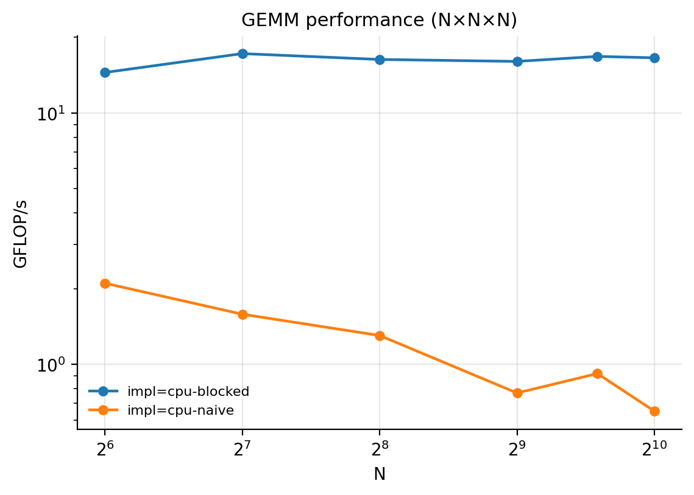

# pdl-bench report

Generated 2026-11-22T15:25:52 from 1 run directory. CSV and LaTeX tables are in each run's `analysis/` folder, figures (PNG + PDF) in `figures/`.

## Experiment `dot1_e1_gemm`

Run directory: `tuannn/experiments/results/dot1_e1_gemm/20261122-152518`

Square GEMM N = 64..1024, cpu-naive vs cpu-blocked, 5 timed repetitions each.

Runs: ok: 1

### Computation benchmark

| op | impl | n | batch | time_mean_s_mean | gflops_mean | rel_err_max |
|---|---|---|---|---|---|---|
| gemm | cpu-blocked | 64 | 0 | 3.62e-05 | 14.48 | 0 |
| gemm | cpu-blocked | 128 | 0 | 0.0002436 | 17.22 | 0 |
| gemm | cpu-blocked | 256 | 0 | 0.002056 | 16.32 | 0 |
| gemm | cpu-blocked | 512 | 0 | 0.01675 | 16.03 | 0 |
| gemm | cpu-blocked | 768 | 0 | 0.05399 | 16.78 | 0 |
| gemm | cpu-blocked | 1024 | 0 | 0.1296 | 16.57 | 0 |
| gemm | cpu-naive | 64 | 0 | 0.0002496 | 2.101 | 0 |
| gemm | cpu-naive | 128 | 0 | 0.002653 | 1.581 | 0 |
| gemm | cpu-naive | 256 | 0 | 0.0258 | 1.301 | 0 |
| gemm | cpu-naive | 512 | 0 | 0.3494 | 0.7682 | 0 |
| gemm | cpu-naive | 768 | 0 | 0.9871 | 0.9178 | 0 |
| gemm | cpu-naive | 1024 | 0 | 3.302 | 0.6503 | 0 |

### Performance model

- Single-node runs: MPI uses shared memory, so α/β describe intra-node copies and the model ignores memory-bandwidth contention between ranks.

### Figures

### Environment

| Item | Value |
|---|---|
| Host | dev-macbook |
| OS | Darwin 22.6.0 x86_64 |
| CPU | Intel(R) Core(TM) i5-8257U CPU @ 1.40GHz |
| Physical cores | 4 |
| Logical CPUs | 8 |
| Memory | 16.0 GiB |
| Compiler | Apple clang version 14.0.3 (clang-1403.0.22.14.1) |
| MPI | HYDRA build details: |
| CMake | cmake version 4.4.5 |
| Python | 3.9.6 |
| Git commit | `5b0f0ac8f200` (dirty) |
