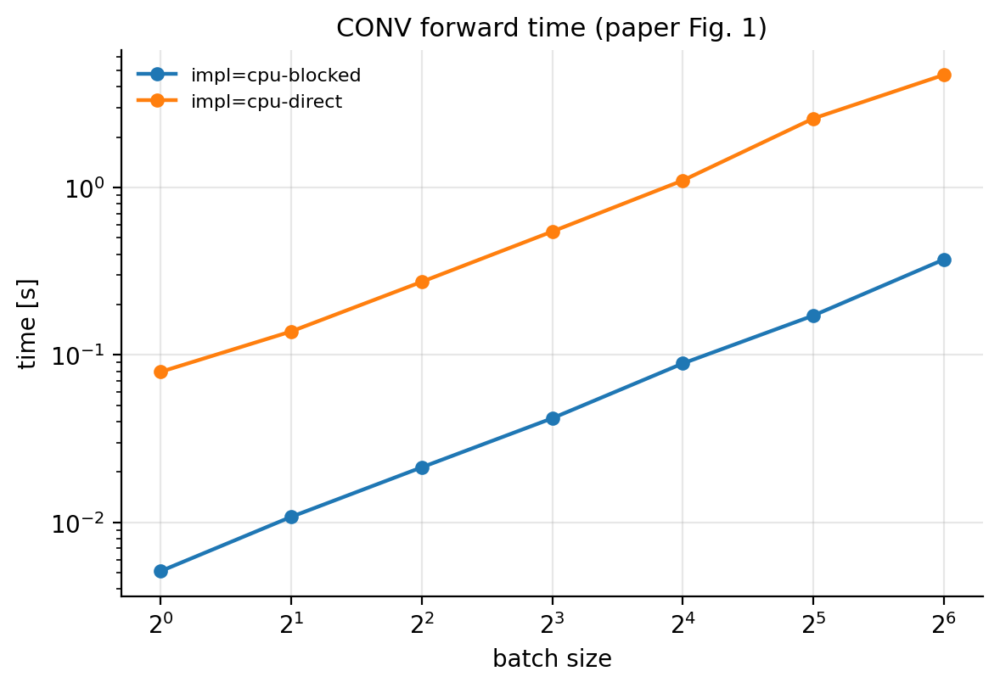
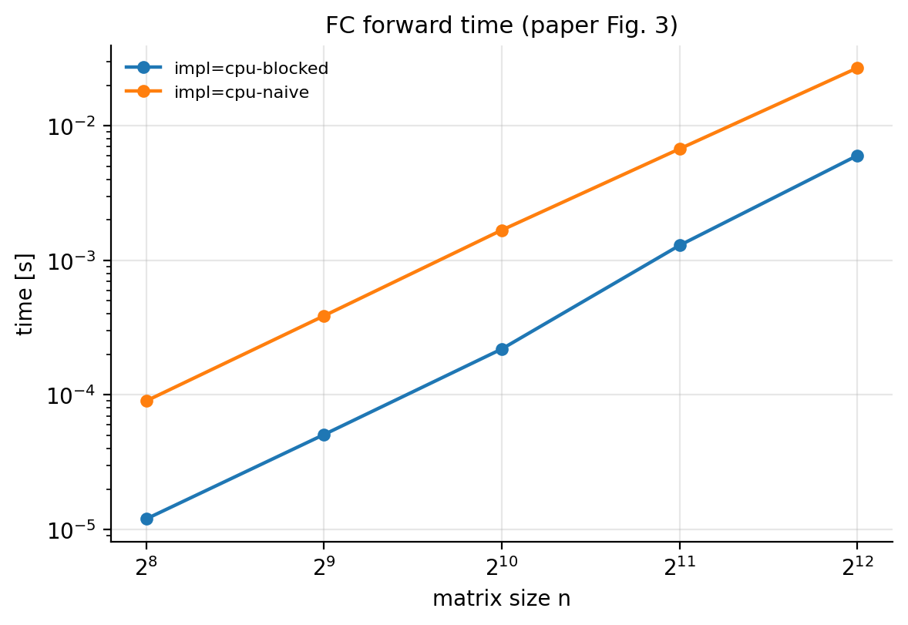

# pdl-bench report

Generated 2026-11-22T15:27:04 from 1 run directory. CSV and LaTeX tables are in each run's `analysis/` folder, figures (PNG + PDF) in `figures/`.

## Experiment `dot1_e2_paper_cpu`

Run directory: `tuannn/experiments/results/dot1_e2_paper_cpu/20261122-152553`

Conv 1:224:224:96:11:4:0 (im2col+GEMM vs direct) for batch 1..64; FC n = 256..4096 at batch 1.

Runs: ok: 2

### Computation benchmark

| op | impl | n | batch | time_mean_s_mean | gflops_mean | throughput_samples_per_s_mean | rel_err_max |
|---|---|---|---|---|---|---|---|
| conv | cpu-blocked | 0 | 1 | 0.00512 | 13.23 | 195.3 | 0 |
| conv | cpu-blocked | 0 | 2 | 0.0108 | 12.54 | 185.1 | 0 |
| conv | cpu-blocked | 0 | 4 | 0.02134 | 12.7 | 187.4 | 0 |
| conv | cpu-blocked | 0 | 8 | 0.0419 | 12.94 | 191 | 0 |
| conv | cpu-blocked | 0 | 16 | 0.08903 | 12.17 | 179.7 | 0 |
| conv | cpu-blocked | 0 | 32 | 0.172 | 12.6 | 186 | 0 |
| conv | cpu-blocked | 0 | 64 | 0.3717 | 11.66 | 172.2 | 0 |
| conv | cpu-direct | 0 | 1 | 0.07928 | 0.8545 | 12.61 | 3.423e-07 |
| conv | cpu-direct | 0 | 2 | 0.1382 | 0.9804 | 14.47 | 3.423e-07 |
| conv | cpu-direct | 0 | 4 | 0.2734 | 0.9912 | 14.63 | 3.423e-07 |
| conv | cpu-direct | 0 | 8 | 0.5458 | 0.993 | 14.66 | 3.912e-07 |
| conv | cpu-direct | 0 | 16 | 1.102 | 0.984 | 14.52 | 3.681e-07 |
| conv | cpu-direct | 0 | 32 | 2.582 | 0.8396 | 12.39 | 3.911e-07 |
| conv | cpu-direct | 0 | 64 | 4.702 | 0.922 | 13.61 | 4.601e-07 |
| fc | cpu-blocked | 256 | 1 | 1.2e-05 | 10.92 | 8.333e+04 | 0 |
| fc | cpu-blocked | 512 | 1 | 5.08e-05 | 10.32 | 1.969e+04 | 0 |
| fc | cpu-blocked | 1024 | 1 | 0.0002196 | 9.55 | 4554 | 0 |
| fc | cpu-blocked | 2048 | 1 | 0.001292 | 6.493 | 774 | 0 |
| fc | cpu-blocked | 4096 | 1 | 0.006008 | 5.585 | 166.4 | 0 |
| fc | cpu-naive | 256 | 1 | 9.04e-05 | 1.45 | 1.106e+04 | 5.017e-07 |
| fc | cpu-naive | 512 | 1 | 0.0003874 | 1.353 | 2581 | 7.213e-07 |
| fc | cpu-naive | 1024 | 1 | 0.001679 | 1.249 | 595.6 | 7.568e-07 |
| fc | cpu-naive | 2048 | 1 | 0.006738 | 1.245 | 148.4 | 1.1e-06 |
| fc | cpu-naive | 4096 | 1 | 0.0269 | 1.247 | 37.17 | 2.341e-06 |

### Performance model

- Single-node runs: MPI uses shared memory, so α/β describe intra-node copies and the model ignores memory-bandwidth contention between ranks.

### Figures

### Environment

| Item | Value |
|---|---|
| Host | dev-macbook |
| OS | Darwin 22.6.0 x86_64 |
| CPU | Intel(R) Core(TM) i5-8257U CPU @ 1.40GHz |
| Physical cores | 4 |
| Logical CPUs | 8 |
| Memory | 16.0 GiB |
| Compiler | Apple clang version 14.0.3 (clang-1403.0.22.14.1) |
| MPI | HYDRA build details: |
| CMake | cmake version 4.4.5 |
| Python | 3.9.6 |
| Git commit | `5b0f0ac8f200` (dirty) |
