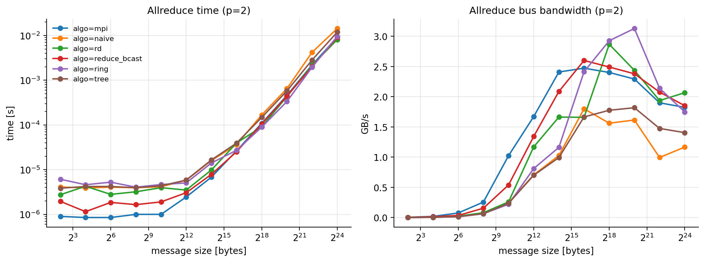
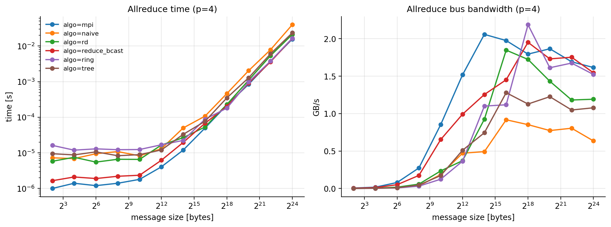
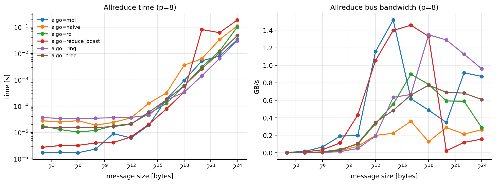
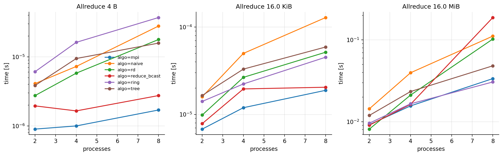
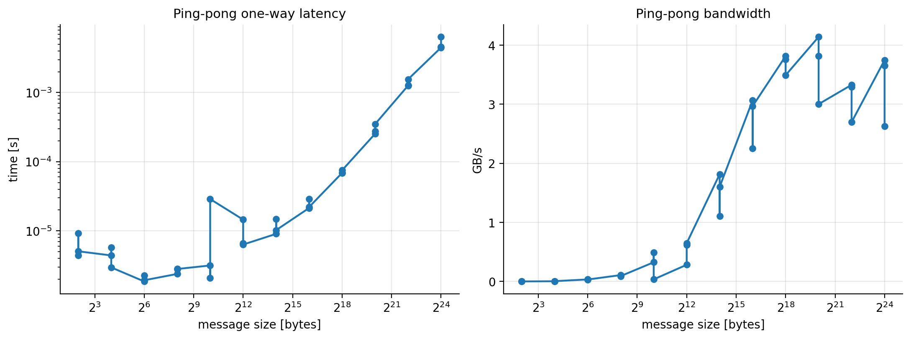

# pdl-bench report

Generated 2026-11-22T15:27:51 from 1 run directory. CSV and LaTeX tables are in each run's `analysis/` folder, figures (PNG + PDF) in `figures/`.

## Experiment `dot1_e3_comm`

Run directory: `tuannn/experiments/results/dot1_e3_comm/20261122-152706`

pdl_bench_comm with k = 2, 4, 8; 4 B .. 16 MiB (x4); 20 repetitions, max over ranks.

Runs: ok: 3

### Key findings

- Fastest allreduce for 16.0 MiB: **rd** (p=2, 8.12 ms).
- Lowest latency allreduce (4 B): **mpi** (0.9 µs).

### Allreduce benchmark

| algo | world_size | bytes | time_mean_s_mean | time_mean_s_ci95 | busbw_Bps_mean |
|---|---|---|---|---|---|
| mpi | 2 | 4 | 9e-07 | – | 4.444e+06 |
| mpi | 4 | 4 | 1e-06 | – | 6e+06 |
| mpi | 8 | 4 | 1.7e-06 | – | 4.118e+06 |
| mpi | 2 | 16 | 8.5e-07 | – | 1.882e+07 |
| mpi | 4 | 16 | 1.4e-06 | – | 1.714e+07 |
| mpi | 8 | 16 | 1.8e-06 | – | 1.556e+07 |
| mpi | 2 | 64 | 8.5e-07 | – | 7.529e+07 |
| mpi | 4 | 64 | 1.2e-06 | – | 8e+07 |
| mpi | 8 | 64 | 1.7e-06 | – | 6.588e+07 |
| mpi | 2 | 256 | 1e-06 | – | 2.56e+08 |
| mpi | 4 | 256 | 1.4e-06 | – | 2.743e+08 |
| mpi | 8 | 256 | 2.35e-06 | – | 1.906e+08 |
| mpi | 2 | 1024 | 1e-06 | – | 1.024e+09 |
| mpi | 4 | 1024 | 1.8e-06 | – | 8.533e+08 |
| mpi | 8 | 1024 | 9.1e-06 | – | 1.969e+08 |
| mpi | 2 | 4096 | 2.45e-06 | – | 1.672e+09 |
| mpi | 4 | 4096 | 4.05e-06 | – | 1.517e+09 |
| mpi | 8 | 4096 | 6.2e-06 | – | 1.156e+09 |
| mpi | 2 | 16384 | 6.8e-06 | – | 2.409e+09 |
| mpi | 4 | 16384 | 1.195e-05 | – | 2.057e+09 |
| mpi | 8 | 16384 | 1.89e-05 | – | 1.517e+09 |
| mpi | 2 | 65536 | 2.65e-05 | – | 2.473e+09 |
| mpi | 4 | 65536 | 4.98e-05 | – | 1.974e+09 |
| mpi | 8 | 65536 | 0.0001857 | – | 6.176e+08 |
| mpi | 2 | 262144 | 0.0001092 | – | 2.402e+09 |
| mpi | 4 | 262144 | 0.0002193 | – | 1.793e+09 |
| mpi | 8 | 262144 | 0.0009414 | – | 4.873e+08 |
| mpi | 2 | 1048576 | 0.0004573 | – | 2.293e+09 |
| mpi | 4 | 1048576 | 0.0008435 | – | 1.865e+09 |
| mpi | 8 | 1048576 | 0.005308 | – | 3.457e+08 |
| mpi | 2 | 4194304 | 0.002208 | – | 1.9e+09 |
| mpi | 4 | 4194304 | 0.003721 | – | 1.691e+09 |
| mpi | 8 | 4194304 | 0.008032 | – | 9.138e+08 |
| mpi | 2 | 16777216 | 0.009198 | – | 1.824e+09 |
| mpi | 4 | 16777216 | 0.01559 | – | 1.614e+09 |
| mpi | 8 | 16777216 | 0.03365 | – | 8.726e+08 |
| naive | 2 | 4 | 4.1e-06 | – | 9.756e+05 |
| naive | 4 | 4 | 7.25e-06 | – | 8.276e+05 |
| naive | 8 | 4 | 2.79e-05 | – | 2.509e+05 |
| naive | 2 | 16 | 3.9e-06 | – | 4.103e+06 |
| naive | 4 | 16 | 6.9e-06 | – | 3.478e+06 |
| naive | 8 | 16 | 2.505e-05 | – | 1.118e+06 |
| naive | 2 | 64 | 4.05e-06 | – | 1.58e+07 |
| naive | 4 | 64 | 9.45e-06 | – | 1.016e+07 |
| naive | 8 | 64 | 2.815e-05 | – | 3.979e+06 |
| naive | 2 | 256 | 3.95e-06 | – | 6.481e+07 |
| naive | 4 | 256 | 1.085e-05 | – | 3.539e+07 |
| naive | 8 | 256 | 1.91e-05 | – | 2.346e+07 |
| naive | 2 | 1024 | 4.15e-06 | – | 2.467e+08 |
| naive | 4 | 1024 | 8.25e-06 | – | 1.862e+08 |
| naive | 8 | 1024 | 2.415e-05 | – | 7.42e+07 |
| naive | 2 | 4096 | 5.8e-06 | – | 7.062e+08 |
| naive | 4 | 4096 | 1.305e-05 | – | 4.708e+08 |
| naive | 8 | 4096 | 3.61e-05 | – | 1.986e+08 |
| naive | 2 | 16384 | 1.595e-05 | – | 1.027e+09 |
| naive | 4 | 16384 | 5e-05 | – | 4.915e+08 |
| naive | 8 | 16384 | 0.0001288 | – | 2.227e+08 |
| naive | 2 | 65536 | 3.64e-05 | – | 1.8e+09 |
| naive | 4 | 65536 | 0.0001072 | – | 9.17e+08 |
| naive | 8 | 65536 | 0.000319 | – | 3.595e+08 |

_156 more rows in the CSV files_

### Performance model

- Hockney fit: α = 2.66 µs, 1/β = 3.37 GB/s, γ = 6.93e-10 s/B
- Allreduce model median |relative error|: 59.2%
- Single-node runs: MPI uses shared memory, so α/β describe intra-node copies and the model ignores memory-bandwidth contention between ranks.

### Figures

### Environment

| Item | Value |
|---|---|
| Host | dev-macbook |
| OS | Darwin 22.6.0 x86_64 |
| CPU | Intel(R) Core(TM) i5-8257U CPU @ 1.40GHz |
| Physical cores | 4 |
| Logical CPUs | 8 |
| Memory | 16.0 GiB |
| Compiler | Apple clang version 14.0.3 (clang-1403.0.22.14.1) |
| MPI | HYDRA build details: |
| CMake | cmake version 4.4.5 |
| Python | 3.9.6 |
| Git commit | `5b0f0ac8f200` (dirty) |
