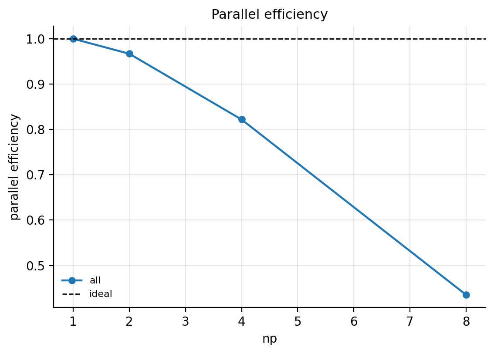
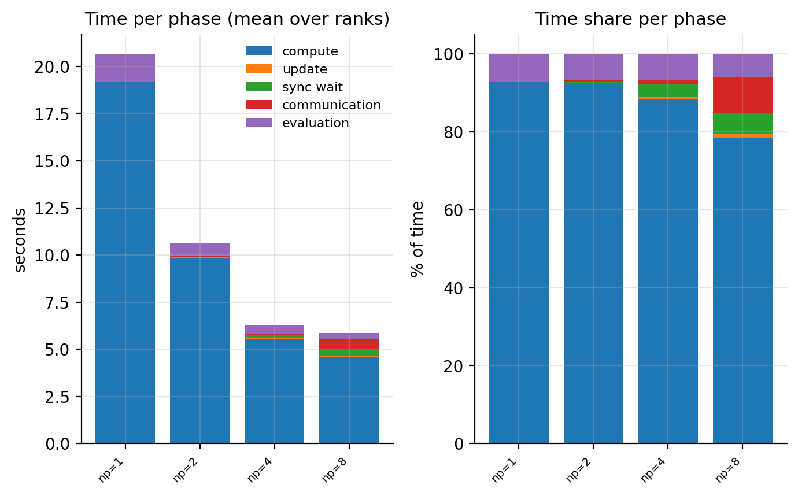
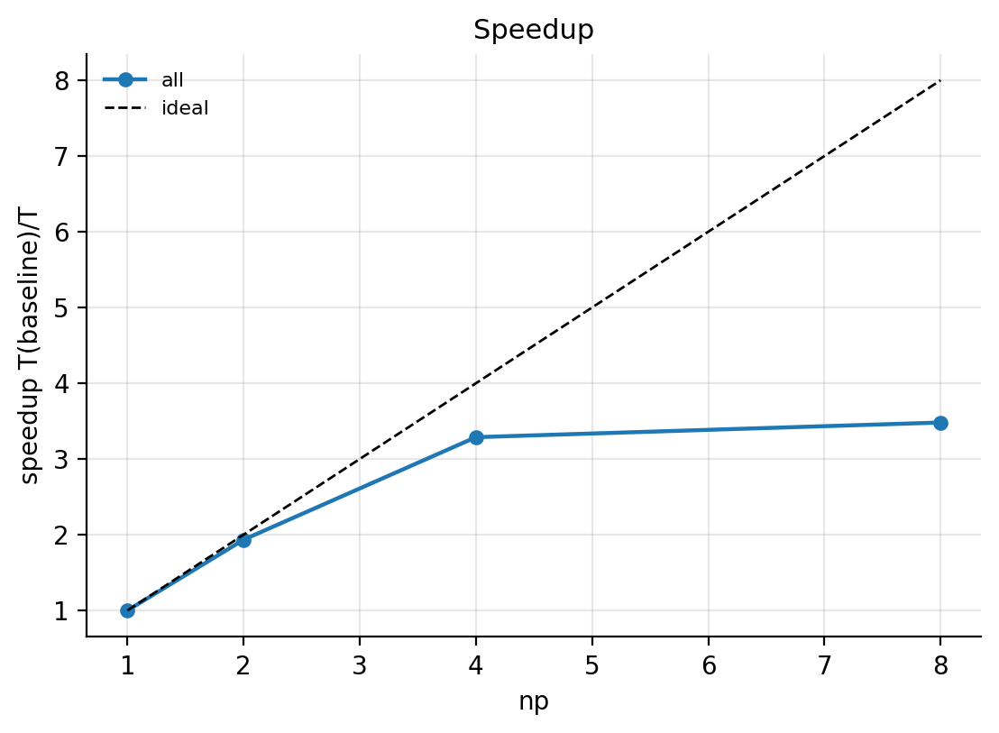
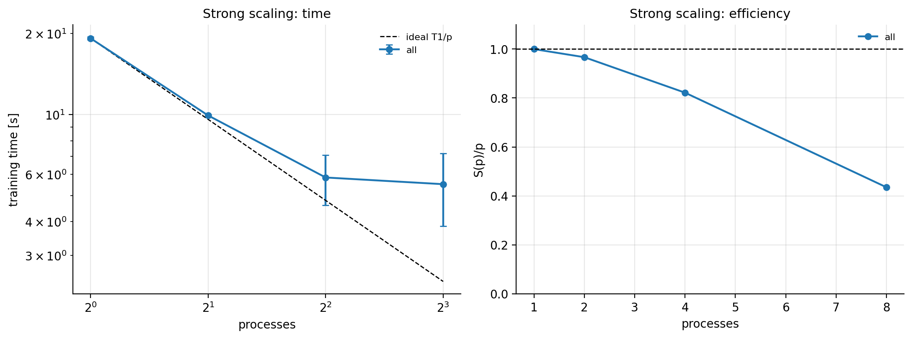
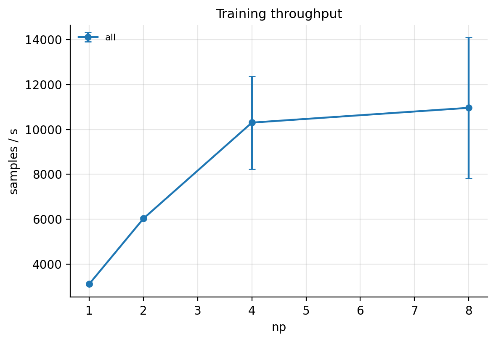

# pdl-bench report

Generated 2026-11-22T15:30:11 from 1 run directory. CSV and LaTeX tables are in each run's `analysis/` folder, figures (PNG + PDF) in `figures/`.

## Experiment `dot1_e4_strong_scaling`

Run directory: `tuannn/experiments/results/dot1_e4_strong_scaling/20261122-152753`

Sync SGD, LeNet on MNIST (60k), global batch 256, 1 epoch, k = 1, 2, 4, 8, 3 repeats, 1 thread per process.

Runs: ok: 12

### Key findings

- Best speedup **3.48×** at np=8 (efficiency 0.435).
- At the largest process count (p=8) parallel efficiency ranges 0.44–0.44.
- Communication + synchronization share of training time: p=1: 0.0%, p=2: 0.6%, p=4: 4.4%, p=8: 14.8%.
- Maximum load imbalance (max/mean compute): 1.00.
- Highest final test accuracy **98.04%** with np=8 in 5.5s.
- Fastest to 96.9% test accuracy: np=8 (5.5s).

### Training summary

| np | n_runs | train_time_s_mean | train_time_s_ci95 | throughput_samples_per_s_mean | speedup | efficiency | comm_fraction_mean | load_imbalance_mean | final_test_acc_mean |
|---|---|---|---|---|---|---|---|---|---|
| 1 | 3 | 19.2 | 0.2483 | 3120 | 1 | 1 | 0 | 1 | 0.9797 |
| 2 | 3 | 9.929 | 0.08463 | 6033 | 1.934 | 0.9669 | 0.005901 | 1.001 | 0.9786 |
| 4 | 3 | 5.841 | 1.227 | 1.03e+04 | 3.288 | 0.8219 | 0.04429 | 1.003 | 0.9789 |
| 8 | 3 | 5.516 | 1.668 | 1.096e+04 | 3.481 | 0.4351 | 0.1483 | 1.005 | 0.9804 |

### Phase breakdown (seconds, mean over ranks)

| np | phase_mean_data_mean | phase_mean_h2d_mean | phase_mean_forward_mean | phase_mean_backward_mean | phase_mean_transfer_mean | phase_mean_sync_wait_mean | phase_mean_comm_mean | phase_mean_update_mean | phase_mean_eval_mean | phase_mean_shuffle_mean |
|---|---|---|---|---|---|---|---|---|---|---|
| 1 | 0.02817 | 0.01773 | 8.624 | 10.52 | 0 | 0 | 0 | 0.01131 | 1.464 | 0 |
| 2 | 0.01912 | 0.008984 | 4.39 | 5.438 | 0 | 0.02706 | 0.03154 | 0.01449 | 0.7274 | 0 |
| 4 | 0.01735 | 0.006181 | 2.558 | 2.964 | 0 | 0.2117 | 0.05379 | 0.02873 | 0.4276 | 0 |
| 8 | 0.01437 | 0.006046 | 2.193 | 2.395 | 0 | 0.3098 | 0.5403 | 0.056 | 0.3492 | 0 |

### Time to accuracy

| config | target | epoch | time_to_target_s |
|---|---|---|---|
| np=1 | 0.9688 | 1 | 19.2 |
| np=2 | 0.9688 | 1 | 9.929 |
| np=4 | 0.9688 | 1 | 5.841 |
| np=8 | 0.9688 | 1 | 5.516 |

### Performance model

- Single-node runs: MPI uses shared memory, so α/β describe intra-node copies and the model ignores memory-bandwidth contention between ranks.

### Figures

### Environment

| Item | Value |
|---|---|
| Host | dev-macbook |
| OS | Darwin 22.6.0 x86_64 |
| CPU | Intel(R) Core(TM) i5-8257U CPU @ 1.40GHz |
| Physical cores | 4 |
| Logical CPUs | 8 |
| Memory | 16.0 GiB |
| Compiler | Apple clang version 14.0.3 (clang-1403.0.22.14.1) |
| MPI | HYDRA build details: |
| CMake | cmake version 4.4.5 |
| Python | 3.9.6 |
| Git commit | `5b0f0ac8f200` (dirty) |
| GPU (binary) | – |
