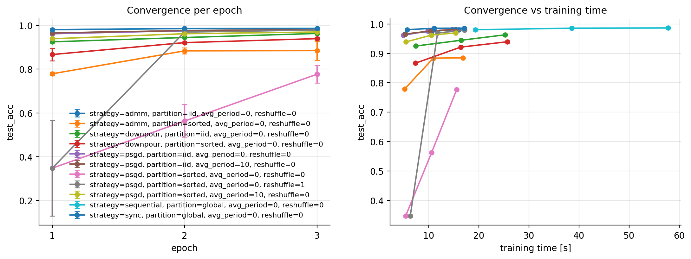
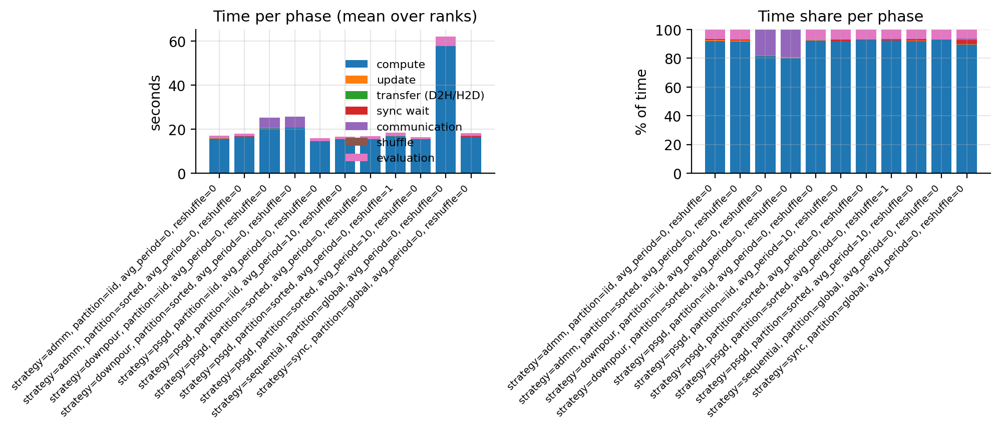
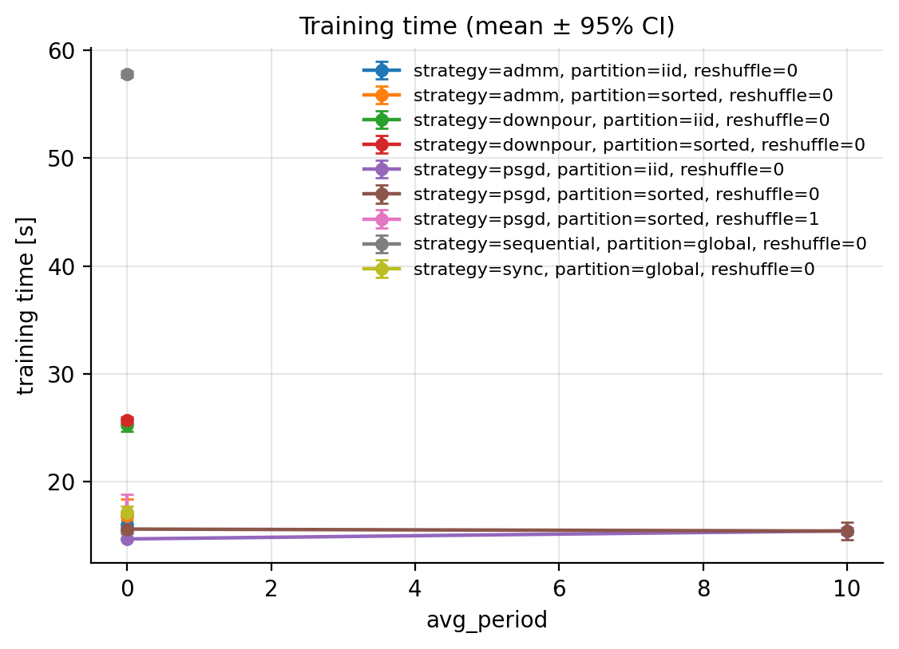

# pdl-bench report

Generated 2026-11-22T15:39:34 from 1 run directory. CSV and LaTeX tables are in each run's `analysis/` folder, figures (PNG + PDF) in `figures/`.

## Experiment `dot1_e5_strategies`

Run directory: `tuannn/experiments/results/dot1_e5_strategies/20261122-153013`

MNIST/LeNet, 3 epochs, 4 processes (Downpour = 1 server + 3 workers), evaluation every epoch, 2 seeds. Sequential and sync use global batch 256 (lr 0.05); psgd/admm/downpour use local batch 64.

Runs: ok: 22

### Key findings

- Best speedup **3.94×** at strategy=psgd, partition=iid, avg_period=0, reshuffle=0 (efficiency 3.94).
- Maximum load imbalance (max/mean compute): 1.00.
- Highest final test accuracy **98.64%** with strategy=sequential, partition=global, avg_period=0, reshuffle=0 in 57.8s.
- Fastest to 76.9% test accuracy: strategy=psgd, partition=iid, avg_period=0, reshuffle=0 (4.9s).

### Training summary

| strategy | partition | avg_period | reshuffle | n_runs | train_time_s_mean | train_time_s_ci95 | throughput_samples_per_s_mean | speedup | efficiency | comm_fraction_mean | load_imbalance_mean | final_test_acc_mean |
|---|---|---|---|---|---|---|---|---|---|---|---|---|
| admm | iid | 0 | 0 | 2 | 15.99 | 7.227 | 1.125e+04 | 3.614 | 3.614 | 0.007256 | 1.001 | 0.9807 |
| admm | sorted | 0 | 0 | 2 | 16.82 | 14 | 1.073e+04 | 3.435 | 3.435 | 0.008851 | 1.002 | 0.8849 |
| downpour | iid | 0 | 0 | 2 | 25.26 | 5.418 | 7117 | 2.288 | 2.288 | 0.1815 | 1 | 0.9631 |
| downpour | sorted | 0 | 0 | 2 | 25.67 | 2.572 | 7001 | 2.251 | 2.251 | 0.1932 | 1.003 | 0.9395 |
| psgd | iid | 0 | 0 | 2 | 14.66 | 0.4159 | 1.226e+04 | 3.943 | 3.943 | 0.001598 | 1.001 | 0.9812 |
| psgd | iid | 10 | 0 | 2 | 15.4 | 2.576 | 1.167e+04 | 3.751 | 3.751 | 0.01098 | 1.001 | 0.9815 |
| psgd | sorted | 0 | 0 | 2 | 15.57 | 1.338 | 1.154e+04 | 3.711 | 3.711 | 0.00277 | 1.002 | 0.7768 |
| psgd | sorted | 0 | 1 | 2 | 17.13 | 14.66 | 1.054e+04 | 3.373 | 3.373 | 0.008987 | 1.001 | 0.9787 |
| psgd | sorted | 10 | 0 | 2 | 15.39 | 7.315 | 1.169e+04 | 3.755 | 3.755 | 0.01227 | 1.002 | 0.9698 |
| sequential | global | 0 | 0 | 2 | 57.79 | 2.765 | 3110 | 1 | 1 | 0 | 1 | 0.9864 |
| sync | global | 0 | 0 | 2 | 17.08 | 5.516 | 1.053e+04 | 3.384 | 3.384 | 0.03847 | 1.002 | 0.9859 |

### Phase breakdown (seconds, mean over ranks)

| strategy | partition | avg_period | reshuffle | phase_mean_data_mean | phase_mean_h2d_mean | phase_mean_forward_mean | phase_mean_backward_mean | phase_mean_transfer_mean | phase_mean_sync_wait_mean | phase_mean_comm_mean | phase_mean_update_mean | phase_mean_eval_mean | phase_mean_shuffle_mean |
|---|---|---|---|---|---|---|---|---|---|---|---|---|---|
| admm | iid | 0 | 0 | 0.02284 | 0.01139 | 7.09 | 8.656 | 0 | 0.1048 | 0.01139 | 0.09315 | 1.148 | 0 |
| admm | sorted | 0 | 0 | 0.02755 | 0.01339 | 7.474 | 9.027 | 0 | 0.139 | 0.01179 | 0.1276 | 1.236 | 0 |
| downpour | iid | 0 | 0 | 0.03736 | 0.01575 | 9.325 | 11.19 | 0.02341 | 0 | 4.557 | 0.09687 | 0 | 0 |
| downpour | sorted | 0 | 0 | 0.03778 | 0.01623 | 9.334 | 11.21 | 0.0235 | 0 | 4.934 | 0.09851 | 0 | 0 |
| psgd | iid | 0 | 0 | 0.01923 | 0.01021 | 6.556 | 8.02 | 0 | 0.02059 | 0.002855 | 0.02656 | 1.156 | 0 |
| psgd | iid | 10 | 0 | 0.02617 | 0.0153 | 6.868 | 8.282 | 0 | 0.1447 | 0.02452 | 0.04323 | 1.139 | 0 |
| psgd | sorted | 0 | 0 | 0.02433 | 0.01156 | 6.967 | 8.485 | 0 | 0.04055 | 0.002544 | 0.0403 | 1.172 | 0 |
| psgd | sorted | 0 | 1 | 0.02257 | 0.01186 | 7.641 | 9.264 | 0 | 0.06552 | 0.005949 | 0.03469 | 1.251 | 0.08527 |
| psgd | sorted | 10 | 0 | 0.02141 | 0.01085 | 6.827 | 8.309 | 0 | 0.1723 | 0.01796 | 0.0309 | 1.088 | 0 |
| sequential | global | 0 | 0 | 0.08195 | 0.05247 | 25.95 | 31.66 | 0 | 0 | 0 | 0.03377 | 4.344 | 0 |
| sync | global | 0 | 0 | 0.05122 | 0.01809 | 7.56 | 8.701 | 0 | 0.491 | 0.1695 | 0.08598 | 1.177 | 0 |

### Time to accuracy

| config | target | epoch | time_to_target_s |
|---|---|---|---|
| strategy=admm, partition=iid, avg_period=0, reshuffle=0 | 0.769 | 1 | 5.198 |
| strategy=admm, partition=sorted, avg_period=0, reshuffle=0 | 0.769 | 1 | 5.167 |
| strategy=downpour, partition=iid, avg_period=0, reshuffle=0 | 0.769 | 1 | 7.386 |
| strategy=downpour, partition=sorted, avg_period=0, reshuffle=0 | 0.769 | 1 | 7.368 |
| strategy=psgd, partition=iid, avg_period=0, reshuffle=0 | 0.769 | 1 | 4.901 |
| strategy=psgd, partition=iid, avg_period=10, reshuffle=0 | 0.769 | 1 | 5.279 |
| strategy=psgd, partition=sorted, avg_period=0, reshuffle=0 | 0.769 | 3 | 15.57 |
| strategy=psgd, partition=sorted, avg_period=0, reshuffle=1 | 0.769 | 2 | 11.76 |
| strategy=psgd, partition=sorted, avg_period=10, reshuffle=0 | 0.769 | 1 | 5.432 |
| strategy=sequential, partition=global, avg_period=0, reshuffle=0 | 0.769 | 1 | 19.33 |
| strategy=sync, partition=global, avg_period=0, reshuffle=0 | 0.769 | 1 | 5.679 |

### Figures

### Environment

| Item | Value |
|---|---|
| Host | dev-macbook |
| OS | Darwin 22.6.0 x86_64 |
| CPU | Intel(R) Core(TM) i5-8257U CPU @ 1.40GHz |
| Physical cores | 4 |
| Logical CPUs | 8 |
| Memory | 16.0 GiB |
| Compiler | Apple clang version 14.0.3 (clang-1403.0.22.14.1) |
| MPI | HYDRA build details: |
| CMake | cmake version 4.4.5 |
| Python | 3.9.6 |
| Git commit | `5b0f0ac8f200` (dirty) |
| GPU (binary) | – |
