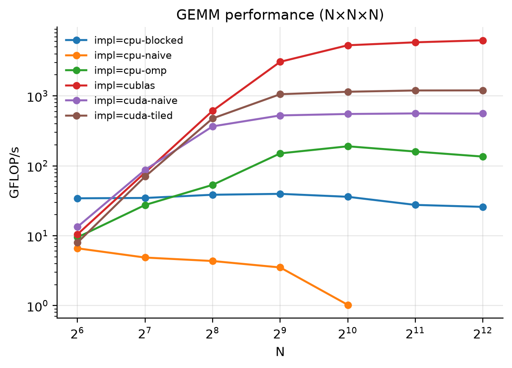

# pdl-bench report

Generated 2026-11-23T00:43:30 from 1 run directory. CSV and LaTeX tables are in each run's `analysis/` folder, figures (PNG + PDF) in `figures/`.

## Experiment `compute_gemm`

Run directory: `../experiments/results/dot2_e1_gemm/20261123-003744`

GFLOP/s of every GEMM implementation (CPU naive/blocked/OpenMP, CUDA naive/tiled/cuBLAS) for square matrices 64..4096.

Runs: ok: 3

### Computation benchmark

| op | impl | n | batch | time_mean_s_mean | gflops_mean | rel_err_max |
|---|---|---|---|---|---|---|
| gemm | cpu-blocked | 64 | 0 | 1.558e-05 | 34.29 | 0 |
| gemm | cpu-blocked | 128 | 0 | 0.0001221 | 34.67 | 0 |
| gemm | cpu-blocked | 256 | 0 | 0.0008759 | 38.54 | 0 |
| gemm | cpu-blocked | 512 | 0 | 0.006809 | 39.7 | 0 |
| gemm | cpu-blocked | 1024 | 0 | 0.05993 | 36.03 | 0 |
| gemm | cpu-blocked | 2048 | 0 | 0.6227 | 27.59 | 0 |
| gemm | cpu-blocked | 4096 | 0 | 5.317 | 25.85 | 0 |
| gemm | cpu-naive | 64 | 0 | 7.942e-05 | 6.606 | 2.317e-07 |
| gemm | cpu-naive | 128 | 0 | 0.0008611 | 4.875 | 2.17e-07 |
| gemm | cpu-naive | 256 | 0 | 0.007721 | 4.348 | 3.023e-07 |
| gemm | cpu-naive | 512 | 0 | 0.07756 | 3.517 | 3.615e-07 |
| gemm | cpu-naive | 1024 | 0 | 2.091 | 1.027 | 3.933e-07 |
| gemm | cpu-omp | 64 | 0 | 0.0009462 | 9.492 | 0 |
| gemm | cpu-omp | 128 | 0 | 0.0001526 | 27.51 | 0 |
| gemm | cpu-omp | 256 | 0 | 0.0006304 | 53.37 | 0 |
| gemm | cpu-omp | 512 | 0 | 0.001785 | 150.5 | 0 |
| gemm | cpu-omp | 1024 | 0 | 0.01131 | 190.1 | 0 |
| gemm | cpu-omp | 2048 | 0 | 0.1075 | 159.9 | 0 |
| gemm | cpu-omp | 4096 | 0 | 1.015 | 135.4 | 0 |
| gemm | cublas | 64 | 0 | 5.201e-05 | 10.49 | 2.78e-07 |
| gemm | cublas | 128 | 0 | 5.487e-05 | 79.98 | 4.372e-07 |
| gemm | cublas | 256 | 0 | 5.778e-05 | 612.9 | 9.1e-07 |
| gemm | cublas | 512 | 0 | 8.797e-05 | 3070 | 1.084e-06 |
| gemm | cublas | 1024 | 0 | 0.0004065 | 5292 | 1.43e-06 |
| gemm | cublas | 2048 | 0 | 0.002945 | 5833 | 2.338e-06 |
| gemm | cublas | 4096 | 0 | 0.02206 | 6231 | 0 |
| gemm | cuda-naive | 64 | 0 | 3.95e-05 | 13.41 | 0 |
| gemm | cuda-naive | 128 | 0 | 4.95e-05 | 87.55 | 0 |
| gemm | cuda-naive | 256 | 0 | 9.189e-05 | 366.4 | 0 |
| gemm | cuda-naive | 512 | 0 | 0.0005118 | 525.3 | 0 |
| gemm | cuda-naive | 1024 | 0 | 0.003902 | 550.7 | 0 |
| gemm | cuda-naive | 2048 | 0 | 0.03063 | 561 | 0 |
| gemm | cuda-naive | 4096 | 0 | 0.2462 | 558.3 | 0 |
| gemm | cuda-tiled | 64 | 0 | 6.867e-05 | 7.984 | 0 |
| gemm | cuda-tiled | 128 | 0 | 6.238e-05 | 70.12 | 0 |
| gemm | cuda-tiled | 256 | 0 | 7.135e-05 | 476.2 | 0 |
| gemm | cuda-tiled | 512 | 0 | 0.0002543 | 1056 | 0 |
| gemm | cuda-tiled | 1024 | 0 | 0.001876 | 1145 | 0 |
| gemm | cuda-tiled | 2048 | 0 | 0.01438 | 1195 | 0 |
| gemm | cuda-tiled | 4096 | 0 | 0.1147 | 1198 | 0 |

### Performance model

- Single-node runs: MPI uses shared memory, so α/β describe intra-node copies and the model ignores memory-bandwidth contention between ranks.

### Figures

### Environment

| Item | Value |
|---|---|
| Host | TuanNguyen |
| OS | Linux 5.15.146.1-microsoft-standard-WSL2 x86_64 |
| CPU | 12th Gen Intel(R) Core(TM) i5-12600K |
| Physical cores | 8 |
| Logical CPUs | 16 |
| Memory | 7.6 GiB |
| GPU | GPU 0: NVIDIA GeForce RTX 2060 (UUID: GPU-32e2fcd7-f21c-bdc3-c469-19441f361371) |
| Compiler | gcc (Ubuntu 13.3.0-6ubuntu2~24.04.1) 13.3.0 |
| CUDA | Build cuda_12.0.r12.0/compiler.32267302_0 |
| MPI | mpirun (Open MPI) 4.1.6 |
| CMake | cmake version 3.28.3 |
| Python | 3.12.3 |
| Git commit | `3e73d8f802d0` (dirty) |
