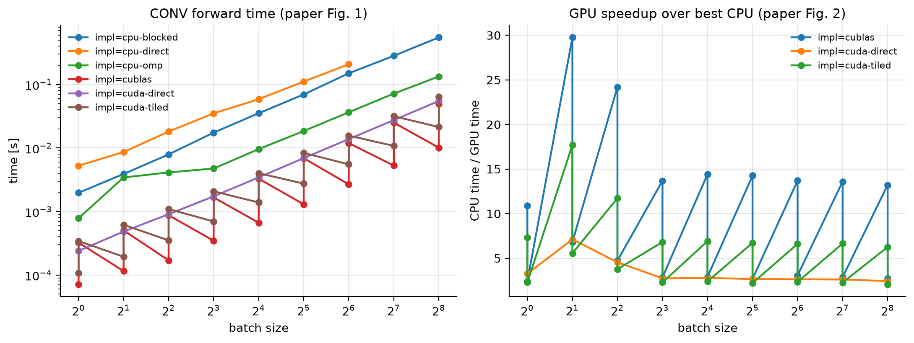
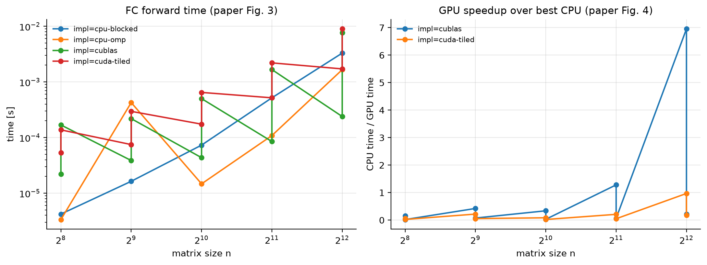

# pdl-bench report

Generated 2026-11-23T00:37:42 from 1 run directory. CSV and LaTeX tables are in each run's `analysis/` folder, figures (PNG + PDF) in `figures/`.

## Experiment `compute_paper_cpu_gpu`

Run directory: `../experiments/results/dot2_e2_paper_cpu_gpu/20261123-003346`

CPU vs GPU forward time of the paper's convolution layer (batch sweep) and of a fully connected layer (matrix-size sweep). GPU timings with and without host<->device copies.

Runs: ok: 18

### Key findings

- Convolution layer at batch 256: GPU is **13.2×** faster than the best CPU implementation (paper reports ≈40× for a GRID K520 vs Xeon).

### Computation benchmark

| op | impl | n | batch | time_mean_s_mean | gflops_mean | throughput_samples_per_s_mean | rel_err_max |
|---|---|---|---|---|---|---|---|
| conv | cpu-blocked | 0 | 1 | 0.00197 | 34.48 | 509 | 0 |
| conv | cpu-blocked | 0 | 2 | 0.0039 | 34.9 | 515.2 | 0 |
| conv | cpu-blocked | 0 | 4 | 0.007922 | 34.28 | 506 | 0 |
| conv | cpu-blocked | 0 | 8 | 0.01747 | 31.05 | 458.3 | 0 |
| conv | cpu-blocked | 0 | 16 | 0.03522 | 30.85 | 455.4 | 0 |
| conv | cpu-blocked | 0 | 32 | 0.06957 | 31.18 | 460.3 | 0 |
| conv | cpu-blocked | 0 | 64 | 0.1499 | 28.98 | 427.8 | 0 |
| conv | cpu-blocked | 0 | 128 | 0.2824 | 30.73 | 453.6 | 0 |
| conv | cpu-blocked | 0 | 256 | 0.5508 | 31.49 | 464.8 | 0 |
| conv | cpu-direct | 0 | 1 | 0.005255 | 12.96 | 191.2 | 3.976e-07 |
| conv | cpu-direct | 0 | 2 | 0.008653 | 16.36 | 241.4 | 4.243e-07 |
| conv | cpu-direct | 0 | 4 | 0.01812 | 15.02 | 221.8 | 4.243e-07 |
| conv | cpu-direct | 0 | 8 | 0.03508 | 16.14 | 238.2 | 4.553e-07 |
| conv | cpu-direct | 0 | 16 | 0.05861 | 18.52 | 273.4 | 4.553e-07 |
| conv | cpu-direct | 0 | 32 | 0.111 | 19.59 | 289.1 | 4.553e-07 |
| conv | cpu-direct | 0 | 64 | 0.2081 | 20.84 | 307.6 | 4.601e-07 |
| conv | cpu-omp | 0 | 1 | 0.000783 | 87.47 | 1291 | 0 |
| conv | cpu-omp | 0 | 2 | 0.003434 | 39.57 | 584.2 | 0 |
| conv | cpu-omp | 0 | 4 | 0.004122 | 65.75 | 970.5 | 0 |
| conv | cpu-omp | 0 | 8 | 0.004748 | 114.7 | 1694 | 0 |
| conv | cpu-omp | 0 | 16 | 0.009593 | 113.5 | 1675 | 0 |
| conv | cpu-omp | 0 | 32 | 0.01848 | 118 | 1742 | 0 |
| conv | cpu-omp | 0 | 64 | 0.03653 | 119 | 1757 | 0 |
| conv | cpu-omp | 0 | 128 | 0.07174 | 121.9 | 1800 | 0 |
| conv | cpu-omp | 0 | 256 | 0.1336 | 129.9 | 1917 | 0 |
| conv | cublas | 0 | 1 | 7.179e-05 | 944 | 1.393e+04 | 0 |
| conv | cublas | 0 | 1 | 0.000324 | 209.2 | 3087 | 0 |
| conv | cublas | 0 | 2 | 0.0001154 | 1182 | 1.745e+04 | 0 |
| conv | cublas | 0 | 2 | 0.0005044 | 269 | 3971 | 0 |
| conv | cublas | 0 | 4 | 0.0001703 | 1593 | 2.352e+04 | 0 |
| conv | cublas | 0 | 4 | 0.0008722 | 310.8 | 4588 | 0 |
| conv | cublas | 0 | 8 | 0.0003469 | 1562 | 2.306e+04 | 0 |
| conv | cublas | 0 | 8 | 0.001666 | 326.6 | 4820 | 0 |
| conv | cublas | 0 | 16 | 0.0006652 | 1630 | 2.406e+04 | 0 |
| conv | cublas | 0 | 16 | 0.003288 | 329.7 | 4867 | 0 |
| conv | cublas | 0 | 32 | 0.001297 | 1672 | 2.468e+04 | 0 |
| conv | cublas | 0 | 32 | 0.006914 | 314.3 | 4640 | 0 |
| conv | cublas | 0 | 64 | 0.002667 | 1628 | 2.403e+04 | 0 |
| conv | cublas | 0 | 64 | 0.0119 | 365.6 | 5396 | 0 |
| conv | cublas | 0 | 128 | 0.005278 | 1645 | 2.429e+04 | 0 |
| conv | cublas | 0 | 128 | 0.02505 | 348.1 | 5138 | 0 |
| conv | cublas | 0 | 256 | 0.01011 | 1716 | 2.534e+04 | 0 |
| conv | cublas | 0 | 256 | 0.04926 | 352.8 | 5208 | 0 |
| conv | cuda-direct | 0 | 1 | 0.0002397 | 283.1 | 4179 | 3.976e-07 |
| conv | cuda-direct | 0 | 2 | 0.0004831 | 282.6 | 4172 | 4.243e-07 |
| conv | cuda-direct | 0 | 4 | 0.000906 | 299.8 | 4425 | 4.243e-07 |
| conv | cuda-direct | 0 | 8 | 0.001733 | 313.3 | 4625 | 4.553e-07 |
| conv | cuda-direct | 0 | 16 | 0.003445 | 315 | 4650 | 4.553e-07 |
| conv | cuda-direct | 0 | 32 | 0.006929 | 313.1 | 4622 | 4.553e-07 |
| conv | cuda-direct | 0 | 64 | 0.0138 | 314.3 | 4639 | 4.601e-07 |
| conv | cuda-direct | 0 | 128 | 0.02745 | 315.9 | 4662 | 5.605e-07 |
| conv | cuda-direct | 0 | 256 | 0.05489 | 316 | 4665 | 5.499e-07 |
| conv | cuda-tiled | 0 | 1 | 0.0001069 | 636 | 9388 | 0 |
| conv | cuda-tiled | 0 | 1 | 0.0003427 | 198.2 | 2925 | 0 |
| conv | cuda-tiled | 0 | 2 | 0.000194 | 698.4 | 1.031e+04 | 0 |
| conv | cuda-tiled | 0 | 2 | 0.0006175 | 219.9 | 3247 | 0 |
| conv | cuda-tiled | 0 | 4 | 0.0003516 | 771 | 1.138e+04 | 0 |
| conv | cuda-tiled | 0 | 4 | 0.001092 | 248.2 | 3663 | 0 |
| conv | cuda-tiled | 0 | 8 | 0.0006969 | 777.8 | 1.148e+04 | 0 |
| conv | cuda-tiled | 0 | 8 | 0.00208 | 260.5 | 3846 | 0 |

_40 more rows in the CSV files_

### Performance model

- Single-node runs: MPI uses shared memory, so α/β describe intra-node copies and the model ignores memory-bandwidth contention between ranks.

### Figures

### Environment

| Item | Value |
|---|---|
| Host | TuanNguyen |
| OS | Linux 5.15.146.1-microsoft-standard-WSL2 x86_64 |
| CPU | 12th Gen Intel(R) Core(TM) i5-12600K |
| Physical cores | 8 |
| Logical CPUs | 16 |
| Memory | 7.6 GiB |
| GPU | GPU 0: NVIDIA GeForce RTX 2060 (UUID: GPU-32e2fcd7-f21c-bdc3-c469-19441f361371) |
| Compiler | gcc (Ubuntu 13.3.0-6ubuntu2~24.04.1) 13.3.0 |
| CUDA | Build cuda_12.0.r12.0/compiler.32267302_0 |
| MPI | mpirun (Open MPI) 4.1.6 |
| CMake | cmake version 3.28.3 |
| Python | 3.12.3 |
| Git commit | `4acdeb458c8a` (dirty) |
