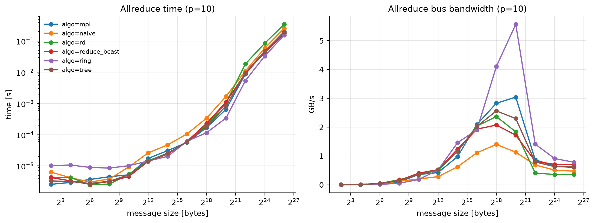
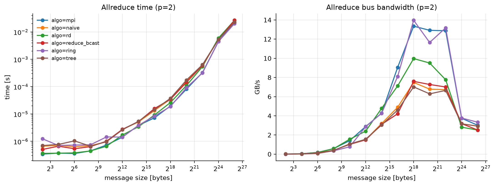
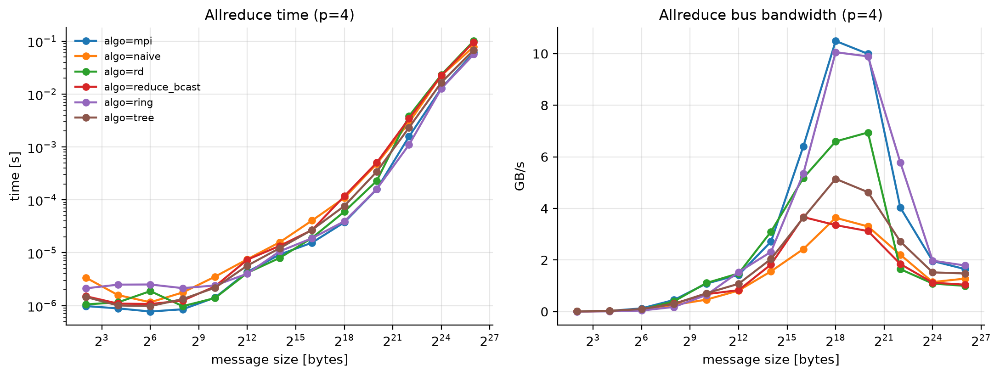
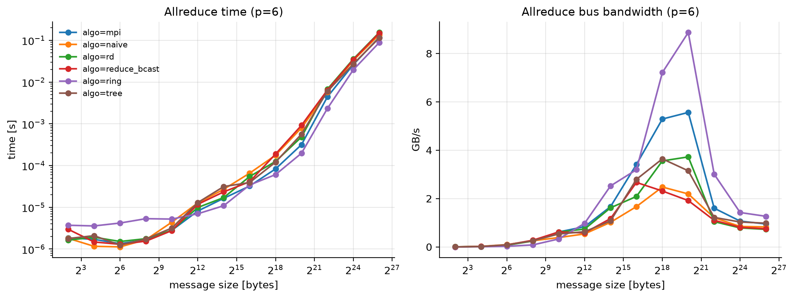
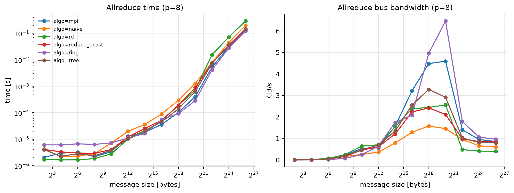
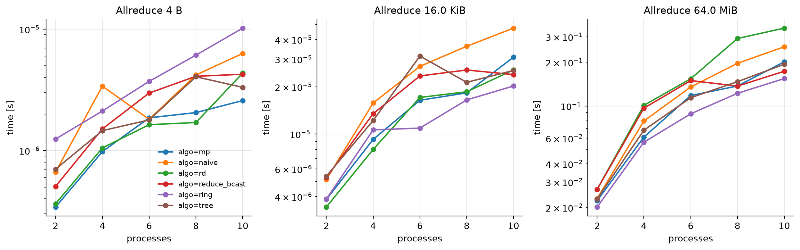
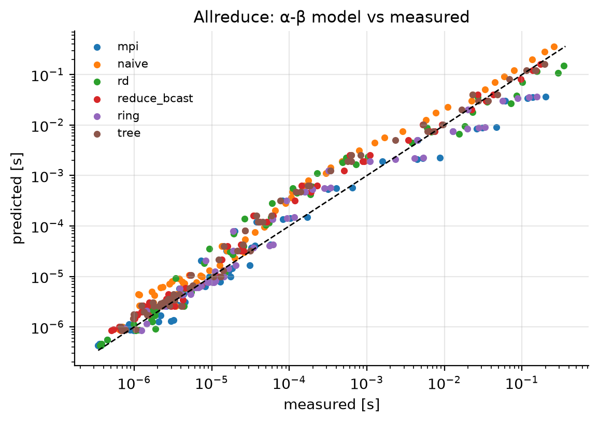
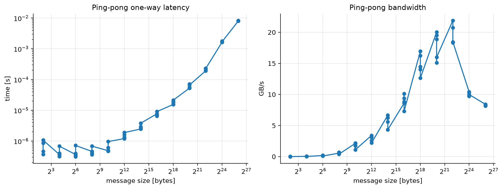

# pdl-bench report

Generated 2026-11-23T00:51:01 from 1 run directory. CSV and LaTeX tables are in each run's `analysis/` folder, figures (PNG + PDF) in `figures/`.

## Experiment `comm_allreduce`

Run directory: `../experiments/results/dot2_e3_comm/20261123-004330`

Allreduce algorithms vs message size (4 B .. 64 MiB) and process count; ping-pong latency and bandwidth provide the alpha-beta parameters for `pdlbench perfmodel`.

Runs: ok: 15

### Key findings

- Fastest allreduce for 64.0 MiB: **ring** (p=2, 20.13 ms).
- Lowest latency allreduce (4 B): **mpi** (0.3 µs).

### Allreduce benchmark

| algo | world_size | bytes | time_mean_s_mean | time_mean_s_ci95 | busbw_Bps_mean |
|---|---|---|---|---|---|
| mpi | 2 | 4 | 3.419e-07 | 5.215e-08 | 1.173e+07 |
| mpi | 4 | 4 | 9.788e-07 | 4.863e-07 | 6.283e+06 |
| mpi | 6 | 4 | 1.859e-06 | 1.789e-06 | 3.906e+06 |
| mpi | 8 | 4 | 2.053e-06 | 2.046e-06 | 3.735e+06 |
| mpi | 10 | 4 | 2.581e-06 | 9.078e-07 | 2.828e+06 |
| mpi | 2 | 16 | 3.717e-07 | 5.444e-08 | 4.314e+07 |
| mpi | 4 | 16 | 8.85e-07 | 1.875e-07 | 2.725e+07 |
| mpi | 6 | 16 | 1.707e-06 | 1.699e-06 | 1.712e+07 |
| mpi | 8 | 16 | 2.968e-06 | 3.636e-06 | 1.157e+07 |
| mpi | 10 | 16 | 2.96e-06 | 1.768e-06 | 1.008e+07 |
| mpi | 2 | 64 | 3.584e-07 | 5.335e-08 | 1.79e+08 |
| mpi | 4 | 64 | 7.725e-07 | 7.051e-08 | 1.244e+08 |
| mpi | 6 | 64 | 1.347e-06 | 1.637e-07 | 7.931e+07 |
| mpi | 8 | 64 | 3.193e-06 | 1.775e-06 | 3.627e+07 |
| mpi | 10 | 64 | 3.682e-06 | 2.501e-06 | 3.3e+07 |
| mpi | 2 | 256 | 4.472e-07 | 1.253e-07 | 5.772e+08 |
| mpi | 4 | 256 | 8.517e-07 | 5.564e-08 | 4.511e+08 |
| mpi | 6 | 256 | 1.669e-06 | 3.871e-07 | 2.571e+08 |
| mpi | 8 | 256 | 2.182e-06 | 1.511e-06 | 2.149e+08 |
| mpi | 10 | 256 | 4.512e-06 | 7.488e-07 | 1.024e+08 |
| mpi | 2 | 1024 | 7.325e-07 | 1.54e-07 | 1.405e+09 |
| mpi | 4 | 1024 | 1.416e-06 | 7.578e-08 | 1.085e+09 |
| mpi | 6 | 1024 | 2.817e-06 | 1.329e-06 | 6.192e+08 |
| mpi | 8 | 1024 | 3.371e-06 | 9.111e-07 | 5.356e+08 |
| mpi | 10 | 1024 | 5.195e-06 | 8.146e-07 | 3.557e+08 |
| mpi | 2 | 4096 | 1.425e-06 | 8.2e-08 | 2.876e+09 |
| mpi | 4 | 4096 | 4.322e-06 | 4.339e-07 | 1.423e+09 |
| mpi | 6 | 4096 | 8.152e-06 | 1.608e-07 | 8.374e+08 |
| mpi | 8 | 4096 | 1.289e-05 | 4.287e-06 | 5.621e+08 |
| mpi | 10 | 4096 | 1.747e-05 | 3.267e-06 | 4.238e+08 |
| mpi | 2 | 16384 | 3.83e-06 | 2.063e-07 | 4.28e+09 |
| mpi | 4 | 16384 | 9.236e-06 | 4.044e-06 | 2.712e+09 |
| mpi | 6 | 16384 | 1.641e-05 | 1.116e-06 | 1.665e+09 |
| mpi | 8 | 16384 | 1.83e-05 | 4.286e-06 | 1.577e+09 |
| mpi | 10 | 16384 | 3.086e-05 | 1.397e-05 | 9.777e+08 |
| mpi | 2 | 65536 | 7.241e-06 | 2.317e-07 | 9.051e+09 |
| mpi | 4 | 65536 | 1.549e-05 | 4.514e-06 | 6.404e+09 |
| mpi | 6 | 65536 | 3.235e-05 | 1.032e-05 | 3.411e+09 |
| mpi | 8 | 65536 | 3.574e-05 | 4.616e-06 | 3.215e+09 |
| mpi | 10 | 65536 | 5.673e-05 | 1.421e-05 | 2.094e+09 |
| mpi | 2 | 262144 | 1.965e-05 | 2.111e-06 | 1.335e+10 |
| mpi | 4 | 262144 | 3.757e-05 | 5.608e-06 | 1.049e+10 |
| mpi | 6 | 262144 | 8.31e-05 | 2.036e-05 | 5.29e+09 |
| mpi | 8 | 262144 | 0.0001027 | 1.958e-05 | 4.483e+09 |
| mpi | 10 | 262144 | 0.0001691 | 5.86e-05 | 2.83e+09 |
| mpi | 2 | 1048576 | 8.117e-05 | 2.914e-06 | 1.292e+10 |
| mpi | 4 | 1048576 | 0.0001581 | 3.156e-05 | 9.992e+09 |
| mpi | 6 | 1048576 | 0.0003162 | 8.09e-05 | 5.564e+09 |
| mpi | 8 | 1048576 | 0.000402 | 8.955e-05 | 4.591e+09 |
| mpi | 10 | 1048576 | 0.0006453 | 0.0003888 | 3.041e+09 |
| mpi | 2 | 4194304 | 0.0003266 | 5.114e-05 | 1.288e+10 |
| mpi | 4 | 4194304 | 0.001572 | 0.0004271 | 4.033e+09 |
| mpi | 6 | 4194304 | 0.004411 | 0.001415 | 1.602e+09 |
| mpi | 8 | 4194304 | 0.00524 | 0.0004501 | 1.402e+09 |
| mpi | 10 | 4194304 | 0.008705 | 0.0009743 | 8.684e+08 |
| mpi | 2 | 16777216 | 0.004489 | 0.0003011 | 3.739e+09 |
| mpi | 4 | 16777216 | 0.01284 | 0.0002246 | 1.96e+09 |
| mpi | 6 | 16777216 | 0.0262 | 0.002929 | 1.069e+09 |
| mpi | 8 | 16777216 | 0.03098 | 0.002495 | 9.484e+08 |
| mpi | 10 | 16777216 | 0.04688 | 0.00421 | 6.448e+08 |

_330 more rows in the CSV files_

### Performance model

- Hockney fit: α = 0.43 µs, 1/β = 14.26 GB/s, γ = 4.6e-10 s/B
- Allreduce model median |relative error|: 43.5%
- Single-node runs: MPI uses shared memory, so α/β describe intra-node copies and the model ignores memory-bandwidth contention between ranks.

### Figures

### Environment

| Item | Value |
|---|---|
| Host | TuanNguyen |
| OS | Linux 5.15.146.1-microsoft-standard-WSL2 x86_64 |
| CPU | 12th Gen Intel(R) Core(TM) i5-12600K |
| Physical cores | 8 |
| Logical CPUs | 16 |
| Memory | 7.6 GiB |
| GPU | GPU 0: NVIDIA GeForce RTX 2060 (UUID: GPU-32e2fcd7-f21c-bdc3-c469-19441f361371) |
| Compiler | gcc (Ubuntu 13.3.0-6ubuntu2~24.04.1) 13.3.0 |
| CUDA | Build cuda_12.0.r12.0/compiler.32267302_0 |
| MPI | mpirun (Open MPI) 4.1.6 |
| CMake | cmake version 3.28.3 |
| Python | 3.12.3 |
| Git commit | `3e73d8f802d0` (dirty) |
