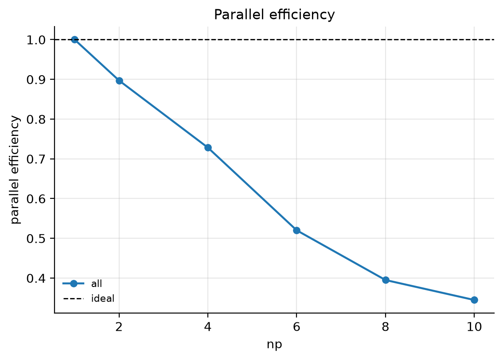
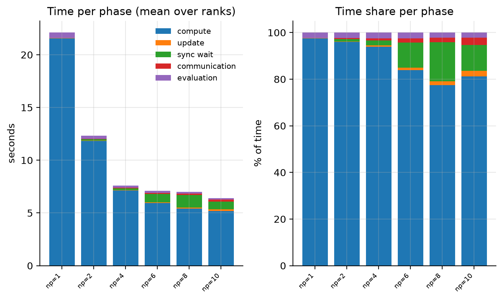
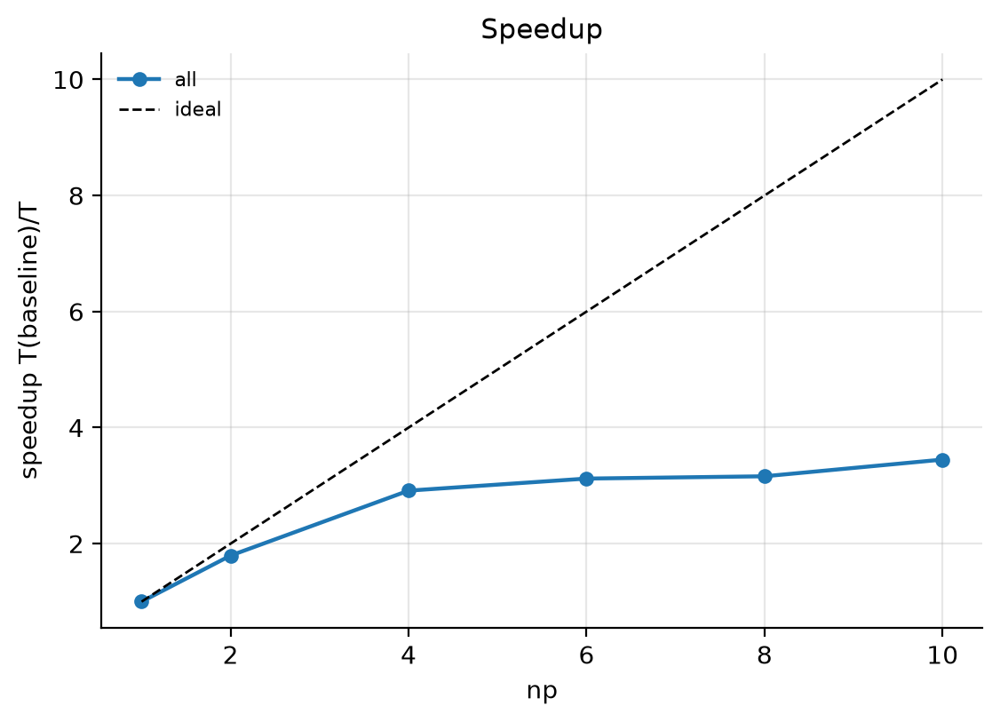
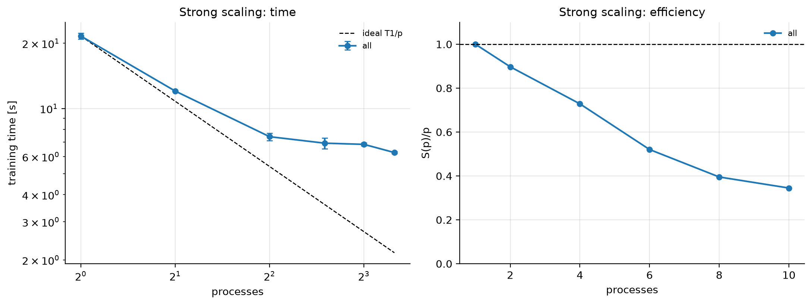
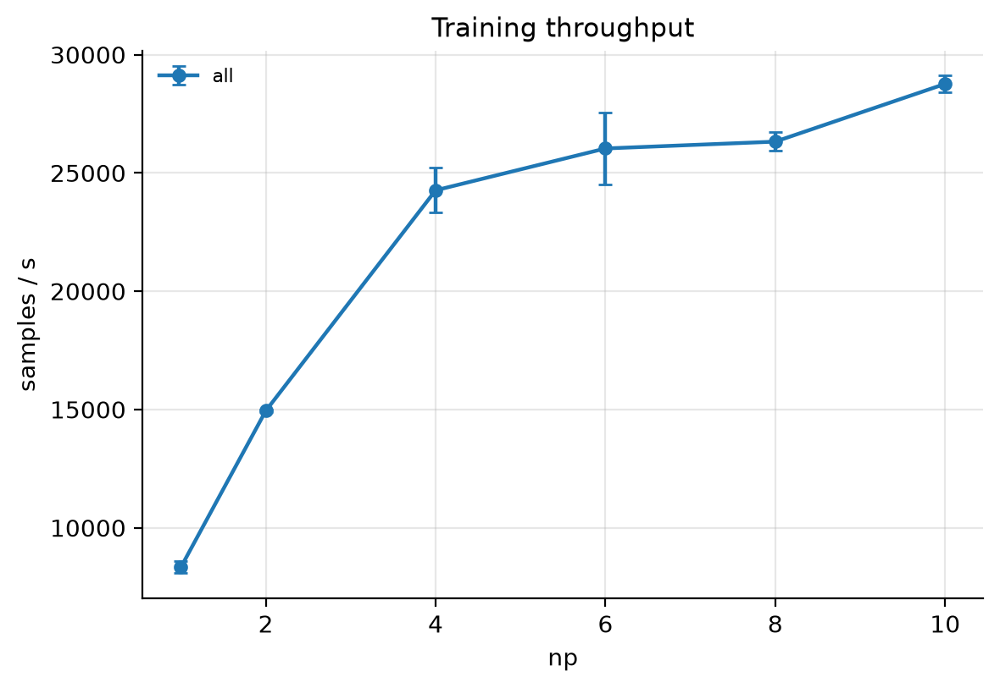
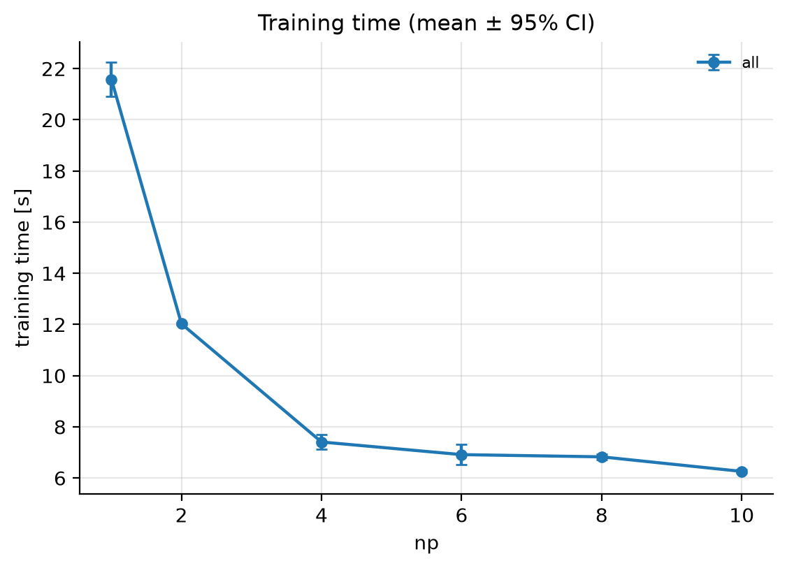

# pdl-bench report

Generated 2026-11-23T00:54:31 from 1 run directory. CSV and LaTeX tables are in each run's `analysis/` folder, figures (PNG + PDF) in `figures/`.

## Experiment `strong_scaling`

Run directory: `../experiments/results/dot2_e4_strong_scaling/20261123-005102`

Synchronous SGD (allreduce of gradients) on MNIST/LeNet with a fixed global batch of 256; 1..10 MPI ranks pinned to cores, 1 OpenMP thread each.

Runs: ok: 18

### Key findings

- Best speedup **3.45×** at np=10 (efficiency 0.345).
- At the largest process count (p=10) parallel efficiency ranges 0.34–0.34.
- Communication + synchronization share of training time: p=1: 0.0%, p=2: 1.5%, p=4: 3.1%, p=6: 12.9%, p=8: 19.0%, p=10: 14.5%.
- Maximum load imbalance (max/mean compute): 1.07.
- Highest final test accuracy **98.57%** with np=8 in 6.8s.
- Fastest to 97.5% test accuracy: np=10 (6.3s).

### Training summary

| np | n_runs | train_time_s_mean | train_time_s_ci95 | throughput_samples_per_s_mean | speedup | efficiency | comm_fraction_mean | load_imbalance_mean | final_test_acc_mean |
|---|---|---|---|---|---|---|---|---|---|
| 1 | 3 | 21.58 | 0.6578 | 8328 | 1 | 1 | 0 | 1 | 0.9853 |
| 2 | 3 | 12.03 | 0.0499 | 1.494e+04 | 1.794 | 0.8972 | 0.01457 | 1.001 | 0.9853 |
| 4 | 3 | 7.407 | 0.2921 | 2.427e+04 | 2.913 | 0.7283 | 0.03129 | 1.005 | 0.9849 |
| 6 | 3 | 6.914 | 0.3982 | 2.603e+04 | 3.121 | 0.5202 | 0.1293 | 1.037 | 0.9847 |
| 8 | 3 | 6.827 | 0.1014 | 2.632e+04 | 3.161 | 0.3951 | 0.1904 | 1.074 | 0.9857 |
| 10 | 3 | 6.258 | 0.07538 | 2.876e+04 | 3.448 | 0.3448 | 0.1454 | 1.035 | 0.9849 |

### Phase breakdown (seconds, mean over ranks)

| np | phase_mean_data_mean | phase_mean_h2d_mean | phase_mean_forward_mean | phase_mean_backward_mean | phase_mean_transfer_mean | phase_mean_sync_wait_mean | phase_mean_comm_mean | phase_mean_update_mean | phase_mean_eval_mean | phase_mean_shuffle_mean |
|---|---|---|---|---|---|---|---|---|---|---|
| 1 | 0.06106 | 0.03662 | 9.347 | 12.11 | 0 | 0 | 0 | 0.02178 | 0.5263 | 0 |
| 2 | 0.04651 | 0.0283 | 5.324 | 6.423 | 0 | 0.1313 | 0.04396 | 0.02905 | 0.2927 | 0 |
| 4 | 0.0332 | 0.01539 | 3.456 | 3.623 | 0 | 0.1612 | 0.07081 | 0.04771 | 0.1865 | 0 |
| 6 | 0.03321 | 0.008349 | 3.08 | 2.822 | 0 | 0.7697 | 0.1256 | 0.07424 | 0.1752 | 0 |
| 8 | 0.03739 | 0.01109 | 2.9 | 2.465 | 0 | 1.169 | 0.131 | 0.1126 | 0.1572 | 0 |
| 10 | 0.04171 | 0.01321 | 2.816 | 2.318 | 0 | 0.7115 | 0.1986 | 0.1572 | 0.1407 | 0 |

### Time to accuracy

| config | target | epoch | time_to_target_s |
|---|---|---|---|
| np=1 | 0.9748 | 3 | 21.58 |
| np=2 | 0.9748 | 3 | 12.03 |
| np=4 | 0.9748 | 3 | 7.407 |
| np=6 | 0.9748 | 3 | 6.914 |
| np=8 | 0.9748 | 3 | 6.827 |
| np=10 | 0.9748 | 3 | 6.258 |

### Performance model

- Single-node runs: MPI uses shared memory, so α/β describe intra-node copies and the model ignores memory-bandwidth contention between ranks.

### Figures

### Environment

| Item | Value |
|---|---|
| Host | TuanNguyen |
| OS | Linux 5.15.146.1-microsoft-standard-WSL2 x86_64 |
| CPU | 12th Gen Intel(R) Core(TM) i5-12600K |
| Physical cores | 8 |
| Logical CPUs | 16 |
| Memory | 7.6 GiB |
| GPU | GPU 0: NVIDIA GeForce RTX 2060 (UUID: GPU-32e2fcd7-f21c-bdc3-c469-19441f361371) |
| Compiler | gcc (Ubuntu 13.3.0-6ubuntu2~24.04.1) 13.3.0 |
| CUDA | Build cuda_12.0.r12.0/compiler.32267302_0 |
| MPI | mpirun (Open MPI) 4.1.6 |
| CMake | cmake version 3.28.3 |
| Python | 3.12.3 |
| Git commit | `3e73d8f802d0` (dirty) |
| GPU (binary) | NVIDIA GeForce RTX 2060 |
