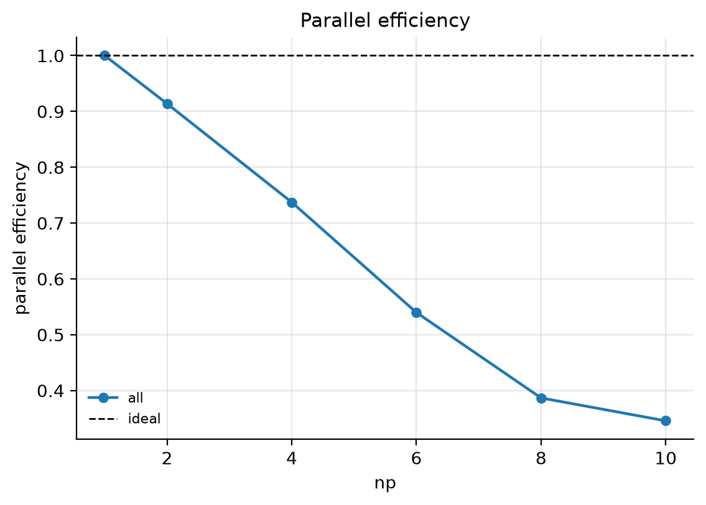
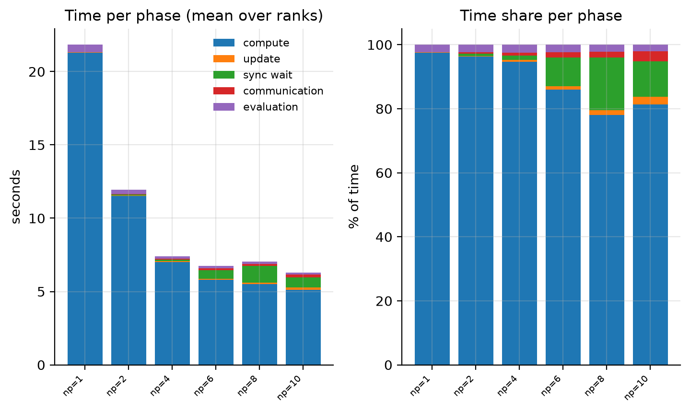
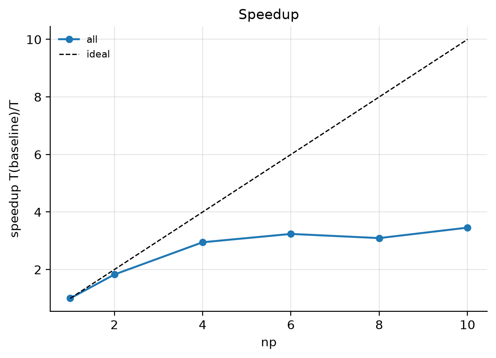
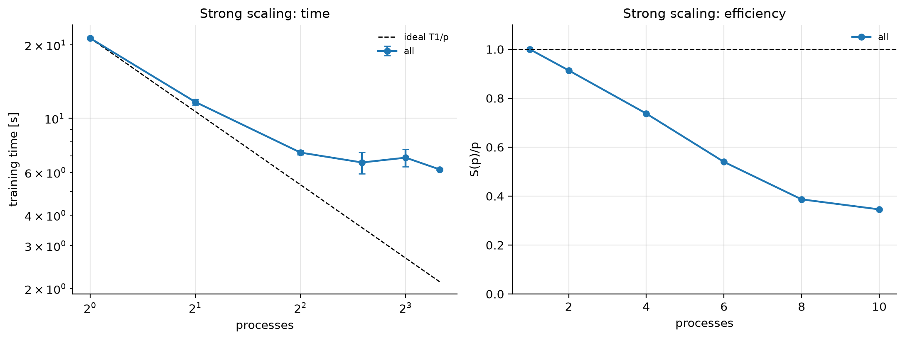
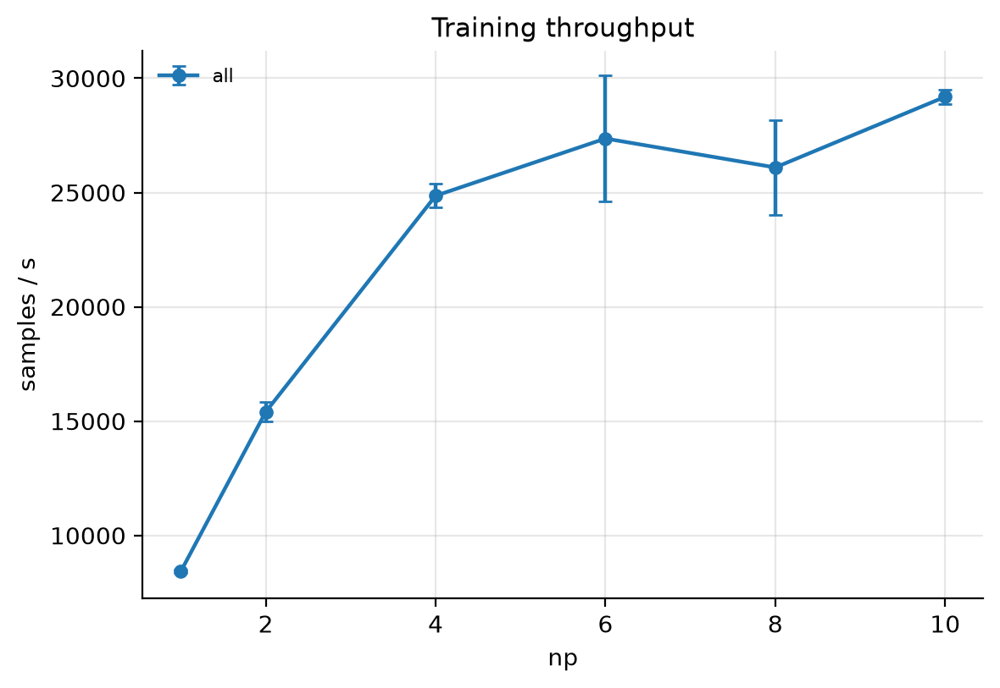
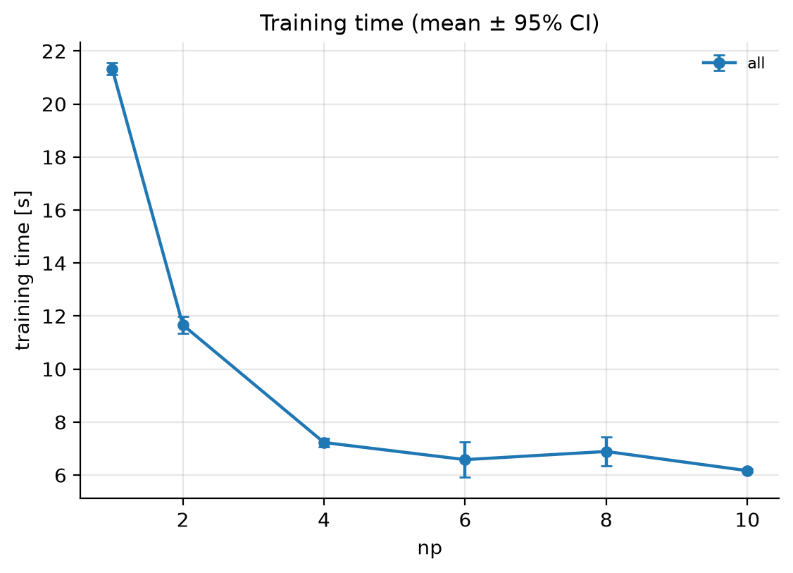

# pdl-bench report

Generated 2026-11-23T01:34:36 from 1 run directory. CSV and LaTeX tables are in each run's `analysis/` folder, figures (PNG + PDF) in `figures/`.

## Experiment `strong_scaling_unbound`

Run directory: `../experiments/results/dot2_e4b_strong_scaling_unbound/20261123-013111`

Synchronous SGD (allreduce of gradients) on MNIST/LeNet with a fixed global batch of 256; 1..10 MPI ranks, NOT pinned, 1 OpenMP thread each.

Runs: ok: 18

### Key findings

- Best speedup **3.46×** at np=10 (efficiency 0.346).
- At the largest process count (p=10) parallel efficiency ranges 0.35–0.35.
- Communication + synchronization share of training time: p=1: 0.0%, p=2: 1.1%, p=4: 2.3%, p=6: 10.9%, p=8: 18.7%, p=10: 14.4%.
- Maximum load imbalance (max/mean compute): 1.05.
- Highest final test accuracy **98.57%** with np=8 in 6.9s.
- Fastest to 97.5% test accuracy: np=10 (6.2s).

### Training summary

| np | n_runs | train_time_s_mean | train_time_s_ci95 | throughput_samples_per_s_mean | speedup | efficiency | comm_fraction_mean | load_imbalance_mean | final_test_acc_mean |
|---|---|---|---|---|---|---|---|---|---|
| 1 | 3 | 21.32 | 0.2243 | 8430 | 1 | 1 | 0 | 1 | 0.9853 |
| 2 | 3 | 11.67 | 0.3196 | 1.541e+04 | 1.828 | 0.9138 | 0.01114 | 1.002 | 0.9853 |
| 4 | 3 | 7.229 | 0.1509 | 2.486e+04 | 2.949 | 0.7373 | 0.02281 | 1.003 | 0.9849 |
| 6 | 3 | 6.583 | 0.6737 | 2.736e+04 | 3.239 | 0.5398 | 0.109 | 1.029 | 0.9847 |
| 8 | 3 | 6.891 | 0.5539 | 2.61e+04 | 3.094 | 0.3867 | 0.1865 | 1.054 | 0.9857 |
| 10 | 3 | 6.167 | 0.0663 | 2.919e+04 | 3.457 | 0.3457 | 0.1442 | 1.027 | 0.9849 |

### Phase breakdown (seconds, mean over ranks)

| np | phase_mean_data_mean | phase_mean_h2d_mean | phase_mean_forward_mean | phase_mean_backward_mean | phase_mean_transfer_mean | phase_mean_sync_wait_mean | phase_mean_comm_mean | phase_mean_update_mean | phase_mean_eval_mean | phase_mean_shuffle_mean |
|---|---|---|---|---|---|---|---|---|---|---|
| 1 | 0.05911 | 0.03483 | 9.211 | 11.99 | 0 | 0 | 0 | 0.02087 | 0.5133 | 0 |
| 2 | 0.04517 | 0.02837 | 5.184 | 6.249 | 0 | 0.08941 | 0.04066 | 0.02753 | 0.2884 | 0 |
| 4 | 0.03193 | 0.01533 | 3.387 | 3.583 | 0 | 0.09513 | 0.0698 | 0.04615 | 0.185 | 0 |
| 6 | 0.03224 | 0.007903 | 3.005 | 2.743 | 0 | 0.6017 | 0.12 | 0.07156 | 0.1539 | 0 |
| 8 | 0.03832 | 0.01086 | 2.94 | 2.502 | 0 | 1.152 | 0.1311 | 0.1151 | 0.1519 | 0 |
| 10 | 0.04052 | 0.0131 | 2.78 | 2.29 | 0 | 0.6972 | 0.1918 | 0.1524 | 0.1324 | 0 |

### Time to accuracy

| config | target | epoch | time_to_target_s |
|---|---|---|---|
| np=1 | 0.9748 | 3 | 21.32 |
| np=2 | 0.9748 | 3 | 11.67 |
| np=4 | 0.9748 | 3 | 7.229 |
| np=6 | 0.9748 | 3 | 6.583 |
| np=8 | 0.9748 | 3 | 6.891 |
| np=10 | 0.9748 | 3 | 6.167 |

### Performance model

- Single-node runs: MPI uses shared memory, so α/β describe intra-node copies and the model ignores memory-bandwidth contention between ranks.

### Figures

### Environment

| Item | Value |
|---|---|
| Host | TuanNguyen |
| OS | Linux 5.15.146.1-microsoft-standard-WSL2 x86_64 |
| CPU | 12th Gen Intel(R) Core(TM) i5-12600K |
| Physical cores | 8 |
| Logical CPUs | 16 |
| Memory | 7.6 GiB |
| GPU | GPU 0: NVIDIA GeForce RTX 2060 (UUID: GPU-32e2fcd7-f21c-bdc3-c469-19441f361371) |
| Compiler | gcc (Ubuntu 13.3.0-6ubuntu2~24.04.1) 13.3.0 |
| CUDA | Build cuda_12.0.r12.0/compiler.32267302_0 |
| MPI | mpirun (Open MPI) 4.1.6 |
| CMake | cmake version 3.28.3 |
| Python | 3.12.3 |
| Git commit | `3e73d8f802d0` (dirty) |
| GPU (binary) | NVIDIA GeForce RTX 2060 |
