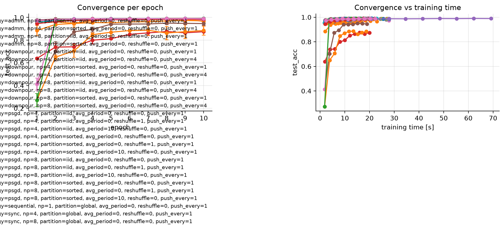
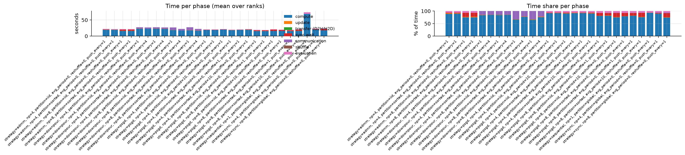
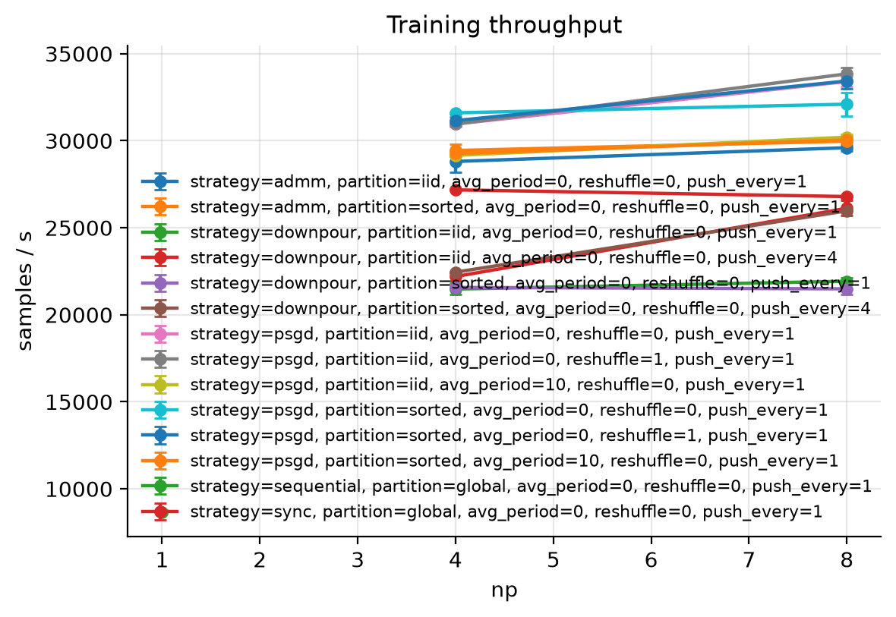
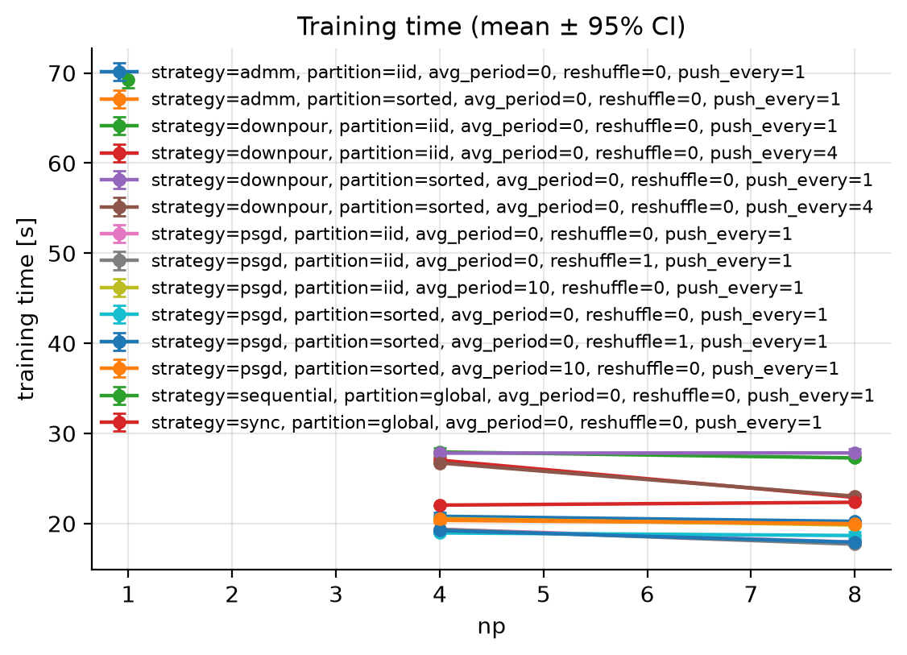

# pdl-bench report

Generated 2026-11-23T01:29:03 from 1 run directory. CSV and LaTeX tables are in each run's `analysis/` folder, figures (PNG + PDF) in `figures/`.

## Experiment `strategies_convergence`

Run directory: `../experiments/results/dot2_e5_strategies/20261123-010528`

MNIST/LeNet, 10 epochs, 4 and 8 ranks (1 thread each), local batch 32; every strategy on IID and label-sorted partitions, evaluated after each epoch.

Runs: ok: 54

### Key findings

- Best speedup **3.91×** at strategy=psgd, np=8, partition=iid, avg_period=0, reshuffle=1, push_every=1 (efficiency 0.489).
- At the largest process count (p=8) parallel efficiency ranges 0.31–0.49.
- Communication + synchronization share of training time: p=1: 0.0%, p=4: 5.9%, p=8: 19.0%.
- Maximum load imbalance (max/mean compute): 1.08.
- Highest final test accuracy **99.11%** with strategy=admm, np=4, partition=iid, avg_period=0, reshuffle=0, push_every=1 in 20.8s.
- Fastest to 86.7% test accuracy: strategy=psgd, np=8, partition=iid, avg_period=0, reshuffle=1, push_every=1 (1.7s).

### Training summary

| strategy | np | partition | avg_period | reshuffle | push_every | n_runs | train_time_s_mean | train_time_s_ci95 | throughput_samples_per_s_mean | speedup | efficiency | comm_fraction_mean | load_imbalance_mean | final_test_acc_mean |
|---|---|---|---|---|---|---|---|---|---|---|---|---|---|---|
| admm | 4 | iid | 0 | 0 | 1 | 2 | 20.8 | 4.033 | 2.881e+04 | 3.328 | 0.8319 | 0.02771 | 1.008 | 0.991 |
| admm | 4 | sorted | 0 | 0 | 1 | 2 | 20.35 | 2.212 | 2.944e+04 | 3.401 | 0.8502 | 0.0215 | 1.007 | 0.969 |
| admm | 8 | iid | 0 | 0 | 1 | 2 | 20.24 | 1.078 | 2.96e+04 | 3.42 | 0.4274 | 0.1685 | 1.039 | 0.9899 |
| admm | 8 | sorted | 0 | 0 | 1 | 2 | 19.99 | 2.182 | 2.998e+04 | 3.463 | 0.4329 | 0.1674 | 1.032 | 0.874 |
| downpour | 4 | iid | 0 | 0 | 1 | 2 | 27.94 | 3.829 | 2.148e+04 | 2.477 | 0.6193 | 0.1529 | 1.005 | 0.9886 |
| downpour | 4 | iid | 0 | 0 | 4 | 2 | 27.03 | 2.75 | 2.22e+04 | 2.56 | 0.64 | 0.1421 | 1.007 | 0.9878 |
| downpour | 4 | sorted | 0 | 0 | 1 | 2 | 27.81 | 0.5798 | 2.157e+04 | 2.488 | 0.6221 | 0.1549 | 1.007 | 0.9726 |
| downpour | 4 | sorted | 0 | 0 | 4 | 2 | 26.73 | 0.3057 | 2.245e+04 | 2.59 | 0.6474 | 0.1411 | 1.003 | 0.9809 |
| downpour | 8 | iid | 0 | 0 | 1 | 2 | 27.28 | 2.075 | 2.193e+04 | 2.537 | 0.3172 | 0.3359 | 1.048 | 0.9885 |
| downpour | 8 | iid | 0 | 0 | 4 | 2 | 22.9 | 3.436 | 2.612e+04 | 3.022 | 0.3778 | 0.2138 | 1.042 | 0.9894 |
| downpour | 8 | sorted | 0 | 0 | 1 | 2 | 27.83 | 3.885 | 2.149e+04 | 2.487 | 0.3108 | 0.3366 | 1.033 | 0.984 |
| downpour | 8 | sorted | 0 | 0 | 4 | 2 | 23.03 | 0.04567 | 2.597e+04 | 3.005 | 0.3757 | 0.2265 | 1.049 | 0.9647 |
| psgd | 4 | iid | 0 | 0 | 1 | 2 | 19.35 | 0.9532 | 3.096e+04 | 3.577 | 0.8942 | 0.01001 | 1.008 | 0.9896 |
| psgd | 4 | iid | 0 | 1 | 1 | 2 | 19.35 | 0.7142 | 3.096e+04 | 3.577 | 0.8941 | 0.01108 | 1.005 | 0.9908 |
| psgd | 4 | iid | 10 | 0 | 1 | 2 | 20.55 | 0.2273 | 2.916e+04 | 3.369 | 0.8422 | 0.02266 | 1.009 | 0.989 |
| psgd | 4 | sorted | 0 | 0 | 1 | 2 | 18.96 | 0.2592 | 3.16e+04 | 3.651 | 0.9128 | 0.007433 | 1.005 | 0.9456 |
| psgd | 4 | sorted | 0 | 1 | 1 | 2 | 19.23 | 1.147 | 3.115e+04 | 3.599 | 0.8998 | 0.01229 | 1.005 | 0.9903 |
| psgd | 4 | sorted | 10 | 0 | 1 | 2 | 20.47 | 0.8697 | 2.926e+04 | 3.38 | 0.8451 | 0.0244 | 1.005 | 0.986 |
| psgd | 8 | iid | 0 | 0 | 1 | 2 | 17.93 | 1.363 | 3.34e+04 | 3.859 | 0.4824 | 0.1155 | 1.061 | 0.99 |
| psgd | 8 | iid | 0 | 1 | 1 | 2 | 17.7 | 1.602 | 3.384e+04 | 3.91 | 0.4887 | 0.1043 | 1.032 | 0.9898 |
| psgd | 8 | iid | 10 | 0 | 1 | 2 | 19.83 | 0.9551 | 3.02e+04 | 3.49 | 0.4362 | 0.1818 | 1.042 | 0.9889 |
| psgd | 8 | sorted | 0 | 0 | 1 | 2 | 18.67 | 3.555 | 3.21e+04 | 3.708 | 0.4635 | 0.1344 | 1.084 | 0.8843 |
| psgd | 8 | sorted | 0 | 1 | 1 | 2 | 17.92 | 2.14 | 3.343e+04 | 3.862 | 0.4828 | 0.1083 | 1.051 | 0.99 |
| psgd | 8 | sorted | 10 | 0 | 1 | 2 | 19.93 | 1.017 | 3.005e+04 | 3.472 | 0.434 | 0.1757 | 1.036 | 0.9832 |
| sequential | 1 | global | 0 | 0 | 1 | 2 | 69.21 | 8.003 | 8656 | 1 | 1 | 0 | 1 | 0.989 |
| sync | 4 | global | 0 | 0 | 1 | 2 | 22.04 | 0.3363 | 2.718e+04 | 3.14 | 0.785 | 0.04113 | 1.01 | 0.9894 |
| sync | 8 | global | 0 | 0 | 1 | 2 | 22.36 | 0.2519 | 2.679e+04 | 3.096 | 0.3869 | 0.1961 | 1.051 | 0.9877 |

### Phase breakdown (seconds, mean over ranks)

| strategy | np | partition | avg_period | reshuffle | push_every | phase_mean_data_mean | phase_mean_h2d_mean | phase_mean_forward_mean | phase_mean_backward_mean | phase_mean_transfer_mean | phase_mean_sync_wait_mean | phase_mean_comm_mean | phase_mean_update_mean | phase_mean_eval_mean | phase_mean_shuffle_mean |
|---|---|---|---|---|---|---|---|---|---|---|---|---|---|---|---|
| admm | 4 | iid | 0 | 0 | 1 | 0.08795 | 0.04387 | 8.679 | 10.86 | 0 | 0.547 | 0.03137 | 0.5419 | 1.347 | 0 |
| admm | 4 | sorted | 0 | 0 | 1 | 0.08874 | 0.04286 | 8.57 | 10.67 | 0 | 0.4082 | 0.02919 | 0.5391 | 1.328 | 0 |
| admm | 8 | iid | 0 | 0 | 1 | 0.06675 | 0.02512 | 7.291 | 8.898 | 0 | 3.379 | 0.03072 | 0.547 | 1.531 | 0 |
| admm | 8 | sorted | 0 | 0 | 1 | 0.06697 | 0.02485 | 7.178 | 8.822 | 0 | 3.315 | 0.03116 | 0.5457 | 1.526 | 0 |
| downpour | 4 | iid | 0 | 0 | 1 | 0.09869 | 0.04842 | 9.916 | 13.08 | 0.1265 | 0 | 4.119 | 0.3423 | 0 | 0 |
| downpour | 4 | iid | 0 | 0 | 4 | 0.09411 | 0.04339 | 9.734 | 12.85 | 0.04247 | 0 | 3.776 | 0.302 | 0 | 0 |
| downpour | 4 | sorted | 0 | 0 | 1 | 0.09563 | 0.04329 | 9.874 | 12.93 | 0.1213 | 0 | 4.154 | 0.3545 | 0 | 0 |
| downpour | 4 | sorted | 0 | 0 | 4 | 0.09183 | 0.04173 | 9.73 | 12.7 | 0.04322 | 0 | 3.719 | 0.308 | 0 | 0 |
| downpour | 8 | iid | 0 | 0 | 1 | 0.08669 | 0.02991 | 8.473 | 9.046 | 0.1546 | 0 | 8.986 | 0.3509 | 0 | 0 |
| downpour | 8 | iid | 0 | 0 | 4 | 0.07328 | 0.02946 | 7.498 | 9.461 | 0.031 | 0 | 4.718 | 0.3804 | 0 | 0 |
| downpour | 8 | sorted | 0 | 0 | 1 | 0.08661 | 0.03035 | 8.683 | 9.126 | 0.1578 | 0 | 9.189 | 0.4134 | 0 | 0 |
| downpour | 8 | sorted | 0 | 0 | 4 | 0.07287 | 0.02929 | 7.359 | 9.28 | 0.03057 | 0 | 5.003 | 0.4299 | 0 | 0 |
| psgd | 4 | iid | 0 | 0 | 1 | 0.07793 | 0.03952 | 8.004 | 10.81 | 0 | 0.1925 | 0.001212 | 0.2193 | 1.348 | 0 |
| psgd | 4 | iid | 0 | 1 | 1 | 0.07717 | 0.04073 | 8.008 | 10.79 | 0 | 0.1081 | 0.001301 | 0.2223 | 1.348 | 0.105 |
| psgd | 4 | iid | 10 | 0 | 1 | 0.09128 | 0.04556 | 8.868 | 10.78 | 0 | 0.4167 | 0.04881 | 0.2885 | 1.333 | 0 |
| psgd | 4 | sorted | 0 | 0 | 1 | 0.07723 | 0.04021 | 7.856 | 10.63 | 0 | 0.1397 | 0.001179 | 0.2105 | 1.291 | 0 |
| psgd | 4 | sorted | 0 | 1 | 1 | 0.07836 | 0.03996 | 7.957 | 10.71 | 0 | 0.1347 | 0.001146 | 0.2039 | 1.321 | 0.1007 |
| psgd | 4 | sorted | 10 | 0 | 1 | 0.09191 | 0.04518 | 8.822 | 10.75 | 0 | 0.4516 | 0.04802 | 0.2599 | 1.338 | 0 |
| psgd | 8 | iid | 0 | 0 | 1 | 0.06542 | 0.02505 | 6.805 | 8.724 | 0 | 2.07 | 0.001977 | 0.2412 | 1.494 | 0 |
| psgd | 8 | iid | 0 | 1 | 1 | 0.06545 | 0.02535 | 6.789 | 8.732 | 0 | 1.754 | 0.00193 | 0.2431 | 1.481 | 0.09005 |
| psgd | 8 | iid | 10 | 0 | 1 | 0.06626 | 0.02396 | 7.245 | 8.631 | 0 | 3.562 | 0.04392 | 0.2599 | 1.533 | 0 |
| psgd | 8 | sorted | 0 | 0 | 1 | 0.06287 | 0.02583 | 6.829 | 8.999 | 0 | 2.509 | 0.001992 | 0.2365 | 1.517 | 0 |
| psgd | 8 | sorted | 0 | 1 | 1 | 0.06451 | 0.02587 | 6.88 | 8.767 | 0 | 1.85 | 0.001952 | 0.2385 | 1.497 | 0.09057 |
| psgd | 8 | sorted | 10 | 0 | 1 | 0.0657 | 0.02442 | 7.329 | 8.724 | 0 | 3.46 | 0.04268 | 0.2857 | 1.512 | 0 |
| sequential | 1 | global | 0 | 0 | 1 | 0.2044 | 0.1081 | 29.8 | 38.92 | 0 | 0 | 0 | 0.1704 | 4.859 | 0 |
| sync | 4 | global | 0 | 0 | 1 | 0.1121 | 0.04923 | 9.755 | 10.92 | 0 | 0.4939 | 0.4127 | 0.2915 | 1.342 | 0 |
| sync | 8 | global | 0 | 0 | 1 | 0.1187 | 0.03544 | 9.401 | 8.042 | 0 | 3.958 | 0.4267 | 0.3733 | 1.528 | 0 |

### Time to accuracy

| config | target | epoch | time_to_target_s |
|---|---|---|---|
| strategy=admm, np=4, partition=iid, avg_period=0, reshuffle=0, push_every=1 | 0.8669 | 1 | 2.079 |
| strategy=admm, np=4, partition=sorted, avg_period=0, reshuffle=0, push_every=1 | 0.8669 | 1 | 2.074 |
| strategy=admm, np=8, partition=iid, avg_period=0, reshuffle=0, push_every=1 | 0.8669 | 1 | 2.042 |
| strategy=admm, np=8, partition=sorted, avg_period=0, reshuffle=0, push_every=1 | 0.8669 | 8 | 16.01 |
| strategy=downpour, np=4, partition=iid, avg_period=0, reshuffle=0, push_every=1 | 0.8669 | 1 | 2.935 |
| strategy=downpour, np=4, partition=iid, avg_period=0, reshuffle=0, push_every=4 | 0.8669 | 1 | 2.56 |
| strategy=downpour, np=4, partition=sorted, avg_period=0, reshuffle=0, push_every=1 | 0.8669 | 1 | 2.749 |
| strategy=downpour, np=4, partition=sorted, avg_period=0, reshuffle=0, push_every=4 | 0.8669 | 1 | 2.496 |
| strategy=downpour, np=8, partition=iid, avg_period=0, reshuffle=0, push_every=1 | 0.8669 | 1 | 2.807 |
| strategy=downpour, np=8, partition=iid, avg_period=0, reshuffle=0, push_every=4 | 0.8669 | 1 | 2.622 |
| strategy=downpour, np=8, partition=sorted, avg_period=0, reshuffle=0, push_every=1 | 0.8669 | 1 | 2.61 |
| strategy=downpour, np=8, partition=sorted, avg_period=0, reshuffle=0, push_every=4 | 0.8669 | 1 | 2.583 |
| strategy=psgd, np=4, partition=iid, avg_period=0, reshuffle=0, push_every=1 | 0.8669 | 1 | 1.956 |
| strategy=psgd, np=4, partition=iid, avg_period=0, reshuffle=1, push_every=1 | 0.8669 | 1 | 1.946 |
| strategy=psgd, np=4, partition=iid, avg_period=10, reshuffle=0, push_every=1 | 0.8669 | 1 | 2.056 |
| strategy=psgd, np=4, partition=sorted, avg_period=0, reshuffle=0, push_every=1 | 0.8669 | 3 | 5.706 |
| strategy=psgd, np=4, partition=sorted, avg_period=0, reshuffle=1, push_every=1 | 0.8669 | 2 | 3.807 |
| strategy=psgd, np=4, partition=sorted, avg_period=10, reshuffle=0, push_every=1 | 0.8669 | 1 | 2.022 |
| strategy=psgd, np=8, partition=iid, avg_period=0, reshuffle=0, push_every=1 | 0.8669 | 1 | 1.735 |
| strategy=psgd, np=8, partition=iid, avg_period=0, reshuffle=1, push_every=1 | 0.8669 | 1 | 1.723 |
| strategy=psgd, np=8, partition=iid, avg_period=10, reshuffle=0, push_every=1 | 0.8669 | 1 | 2.003 |
| strategy=psgd, np=8, partition=sorted, avg_period=0, reshuffle=0, push_every=1 | 0.8669 | 5 | 9.868 |
| strategy=psgd, np=8, partition=sorted, avg_period=0, reshuffle=1, push_every=1 | 0.8669 | 2 | 3.616 |
| strategy=psgd, np=8, partition=sorted, avg_period=10, reshuffle=0, push_every=1 | 0.8669 | 1 | 2.011 |
| strategy=sequential, np=1, partition=global, avg_period=0, reshuffle=0, push_every=1 | 0.8669 | 1 | 6.898 |
| strategy=sync, np=4, partition=global, avg_period=0, reshuffle=0, push_every=1 | 0.8669 | 1 | 2.208 |
| strategy=sync, np=8, partition=global, avg_period=0, reshuffle=0, push_every=1 | 0.8669 | 1 | 2.285 |

### Performance model

- Downpour 0012_strategy-downpour_np-4_batchsiz-32_partitio-iid_pushever-1_fetcheve-1_r0: T=3.79 ms, τ=1.280 ms → k* = T/τ ≈ 3.0 workers (used 3)
- Downpour 0013_strategy-downpour_np-4_batchsiz-32_partitio-iid_pushever-1_fetcheve-1_r1: T=3.73 ms, τ=1.258 ms → k* = T/τ ≈ 3.0 workers (used 3)
- Downpour 0014_strategy-downpour_np-4_batchsiz-32_partitio-iid_pushever-4_fetcheve-4_r0: T=14.69 ms, τ=2.806 ms → k* = T/τ ≈ 5.2 workers (used 3)
- Downpour 0015_strategy-downpour_np-4_batchsiz-32_partitio-iid_pushever-4_fetcheve-4_r1: T=14.79 ms, τ=2.944 ms → k* = T/τ ≈ 5.0 workers (used 3)
- Downpour 0024_strategy-downpour_np-4_batchsiz-32_partitio-sorted_pushever-1_fetcheve-1_r0: T=3.72 ms, τ=1.255 ms → k* = T/τ ≈ 3.0 workers (used 3)
- Downpour 0025_strategy-downpour_np-4_batchsiz-32_partitio-sorted_pushever-1_fetcheve-1_r1: T=3.73 ms, τ=1.260 ms → k* = T/τ ≈ 3.0 workers (used 3)
- Downpour 0026_strategy-downpour_np-4_batchsiz-32_partitio-sorted_pushever-4_fetcheve-4_r0: T=14.69 ms, τ=2.803 ms → k* = T/τ ≈ 5.2 workers (used 3)
- Downpour 0027_strategy-downpour_np-4_batchsiz-32_partitio-sorted_pushever-4_fetcheve-4_r1: T=14.58 ms, τ=2.946 ms → k* = T/τ ≈ 5.0 workers (used 3)
- Downpour 0038_strategy-downpour_np-8_batchsiz-32_partitio-iid_pushever-1_fetcheve-1_r0: T=6.73 ms, τ=1.197 ms → k* = T/τ ≈ 5.6 workers (used 7)
- Downpour 0039_strategy-downpour_np-8_batchsiz-32_partitio-iid_pushever-1_fetcheve-1_r1: T=6.74 ms, τ=1.188 ms → k* = T/τ ≈ 5.7 workers (used 7)
- Downpour 0040_strategy-downpour_np-8_batchsiz-32_partitio-iid_pushever-4_fetcheve-4_r0: T=26.03 ms, τ=3.583 ms → k* = T/τ ≈ 7.3 workers (used 7)
- Downpour 0041_strategy-downpour_np-8_batchsiz-32_partitio-iid_pushever-4_fetcheve-4_r1: T=26.23 ms, τ=3.605 ms → k* = T/τ ≈ 7.3 workers (used 7)
- Downpour 0050_strategy-downpour_np-8_batchsiz-32_partitio-sorted_pushever-1_fetcheve-1_r0: T=6.83 ms, τ=1.200 ms → k* = T/τ ≈ 5.7 workers (used 7)
- Downpour 0051_strategy-downpour_np-8_batchsiz-32_partitio-sorted_pushever-1_fetcheve-1_r1: T=6.91 ms, τ=1.204 ms → k* = T/τ ≈ 5.7 workers (used 7)
- Downpour 0052_strategy-downpour_np-8_batchsiz-32_partitio-sorted_pushever-4_fetcheve-4_r0: T=25.53 ms, τ=3.516 ms → k* = T/τ ≈ 7.3 workers (used 7)
- Downpour 0053_strategy-downpour_np-8_batchsiz-32_partitio-sorted_pushever-4_fetcheve-4_r1: T=25.92 ms, τ=3.579 ms → k* = T/τ ≈ 7.2 workers (used 7)
- Single-node runs: MPI uses shared memory, so α/β describe intra-node copies and the model ignores memory-bandwidth contention between ranks.

### Figures

### Environment

| Item | Value |
|---|---|
| Host | TuanNguyen |
| OS | Linux 5.15.146.1-microsoft-standard-WSL2 x86_64 |
| CPU | 12th Gen Intel(R) Core(TM) i5-12600K |
| Physical cores | 8 |
| Logical CPUs | 16 |
| Memory | 7.6 GiB |
| GPU | GPU 0: NVIDIA GeForce RTX 2060 (UUID: GPU-32e2fcd7-f21c-bdc3-c469-19441f361371) |
| Compiler | gcc (Ubuntu 13.3.0-6ubuntu2~24.04.1) 13.3.0 |
| CUDA | Build cuda_12.0.r12.0/compiler.32267302_0 |
| MPI | mpirun (Open MPI) 4.1.6 |
| CMake | cmake version 3.28.3 |
| Python | 3.12.3 |
| Git commit | `3e73d8f802d0` (dirty) |
| GPU (binary) | NVIDIA GeForce RTX 2060 |
