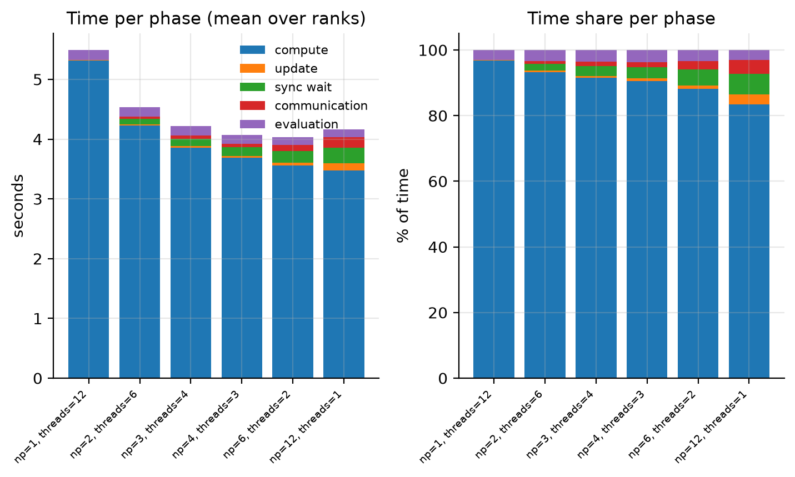
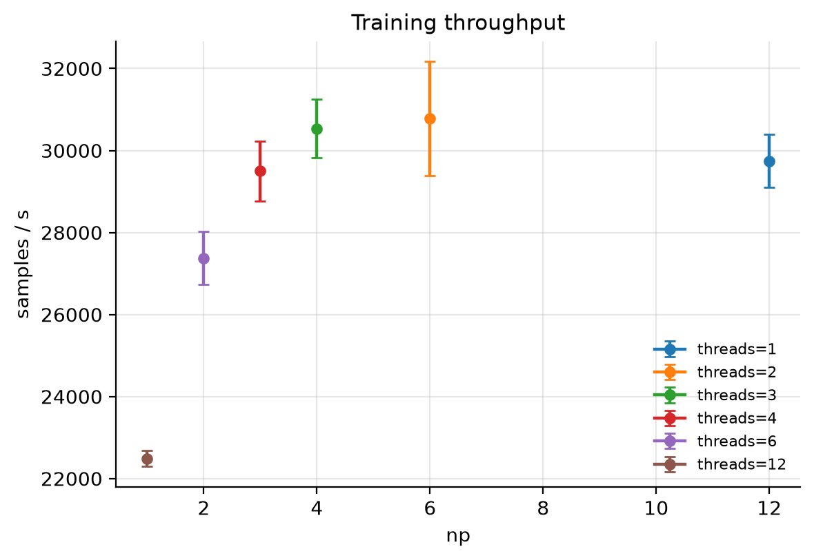
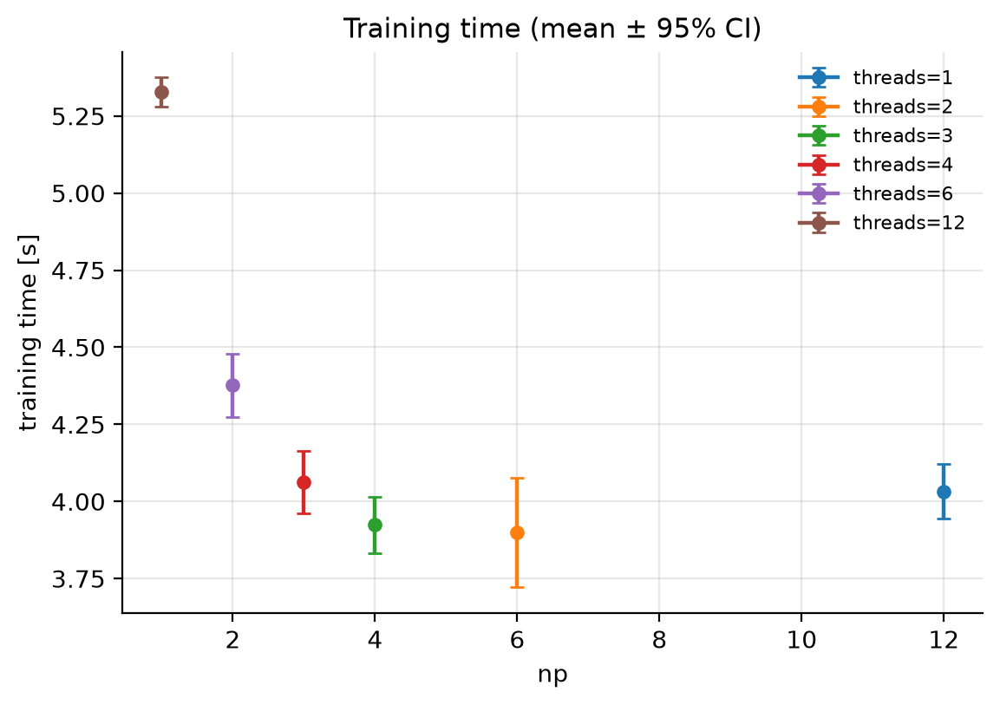

# pdl-bench report

Generated 2026-11-23T00:56:09 from 1 run directory. CSV and LaTeX tables are in each run's `analysis/` folder, figures (PNG + PDF) in `figures/`.

## Experiment `hybrid_mpi_omp`

Run directory: `../experiments/results/dot2_e6_hybrid/20261123-005431`

Synchronous SGD on MNIST/LeNet, global batch 256, 12 threads in total split between MPI ranks and OpenMP threads per rank (no core binding so threads can spread).

Runs: ok: 18

### Key findings

- Best speedup **1.37×** at np=6, threads=2 (efficiency 0.228).
- At the largest process count (p=12) parallel efficiency ranges 0.11–0.11.
- Communication + synchronization share of training time: p=1: 0.0%, p=2: 3.0%, p=3: 4.4%, p=4: 5.2%, p=6: 7.6%, p=12: 10.7%.
- Maximum load imbalance (max/mean compute): 1.02.
- Highest final test accuracy **98.41%** with np=4, threads=3 in 3.9s.
- Fastest to 97.4% test accuracy: np=6, threads=2 (3.9s).

### Training summary

| np | threads | n_runs | train_time_s_mean | train_time_s_ci95 | throughput_samples_per_s_mean | speedup | efficiency | comm_fraction_mean | load_imbalance_mean | final_test_acc_mean |
|---|---|---|---|---|---|---|---|---|---|---|
| 1 | 12 | 3 | 5.327 | 0.04751 | 2.249e+04 | 1 | 1 | 0 | 1 | 0.9838 |
| 2 | 6 | 3 | 4.376 | 0.1027 | 2.738e+04 | 1.217 | 0.6086 | 0.0298 | 1.002 | 0.9835 |
| 3 | 4 | 3 | 4.063 | 0.1007 | 2.95e+04 | 1.311 | 0.437 | 0.04396 | 1.003 | 0.9833 |
| 4 | 3 | 3 | 3.923 | 0.09121 | 3.054e+04 | 1.358 | 0.3394 | 0.05206 | 1.008 | 0.9841 |
| 6 | 2 | 3 | 3.899 | 0.1777 | 3.077e+04 | 1.366 | 0.2277 | 0.07583 | 1.007 | 0.9835 |
| 12 | 1 | 3 | 4.032 | 0.08791 | 2.975e+04 | 1.321 | 0.1101 | 0.1071 | 1.023 | 0.9839 |

### Phase breakdown (seconds, mean over ranks)

| np | threads | phase_mean_data_mean | phase_mean_h2d_mean | phase_mean_forward_mean | phase_mean_backward_mean | phase_mean_transfer_mean | phase_mean_sync_wait_mean | phase_mean_comm_mean | phase_mean_update_mean | phase_mean_eval_mean | phase_mean_shuffle_mean |
|---|---|---|---|---|---|---|---|---|---|---|---|
| 1 | 12 | 0.04766 | 0.03158 | 1.873 | 3.362 | 0 | 0 | 0 | 0.01264 | 0.1652 | 0 |
| 2 | 6 | 0.03479 | 0.02381 | 1.794 | 2.374 | 0 | 0.09376 | 0.0367 | 0.01873 | 0.1551 | 0 |
| 3 | 4 | 0.02938 | 0.01983 | 1.769 | 2.042 | 0 | 0.1233 | 0.05532 | 0.024 | 0.1533 | 0 |
| 4 | 3 | 0.0245 | 0.01617 | 1.768 | 1.878 | 0 | 0.1435 | 0.06077 | 0.0312 | 0.1499 | 0 |
| 6 | 2 | 0.02449 | 0.009259 | 1.82 | 1.704 | 0 | 0.1949 | 0.1007 | 0.045 | 0.1387 | 0 |
| 12 | 1 | 0.02761 | 0.009464 | 1.893 | 1.542 | 0 | 0.2587 | 0.1734 | 0.1273 | 0.1291 | 0 |

### Time to accuracy

| config | target | epoch | time_to_target_s |
|---|---|---|---|
| np=1, threads=12 | 0.9735 | 2 | 5.327 |
| np=2, threads=6 | 0.9735 | 2 | 4.376 |
| np=3, threads=4 | 0.9735 | 2 | 4.063 |
| np=4, threads=3 | 0.9735 | 2 | 3.923 |
| np=6, threads=2 | 0.9735 | 2 | 3.899 |
| np=12, threads=1 | 0.9735 | 2 | 4.032 |

### Performance model

- Single-node runs: MPI uses shared memory, so α/β describe intra-node copies and the model ignores memory-bandwidth contention between ranks.

### Figures

### Environment

| Item | Value |
|---|---|
| Host | TuanNguyen |
| OS | Linux 5.15.146.1-microsoft-standard-WSL2 x86_64 |
| CPU | 12th Gen Intel(R) Core(TM) i5-12600K |
| Physical cores | 8 |
| Logical CPUs | 16 |
| Memory | 7.6 GiB |
| GPU | GPU 0: NVIDIA GeForce RTX 2060 (UUID: GPU-32e2fcd7-f21c-bdc3-c469-19441f361371) |
| Compiler | gcc (Ubuntu 13.3.0-6ubuntu2~24.04.1) 13.3.0 |
| CUDA | Build cuda_12.0.r12.0/compiler.32267302_0 |
| MPI | mpirun (Open MPI) 4.1.6 |
| CMake | cmake version 3.28.3 |
| Python | 3.12.3 |
| Git commit | `3e73d8f802d0` (dirty) |
| GPU (binary) | NVIDIA GeForce RTX 2060 |
