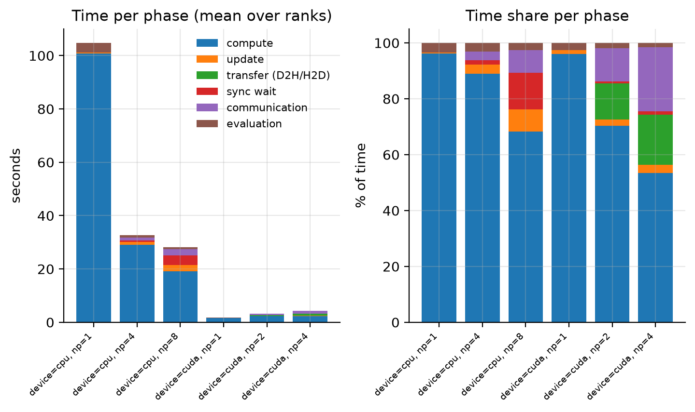
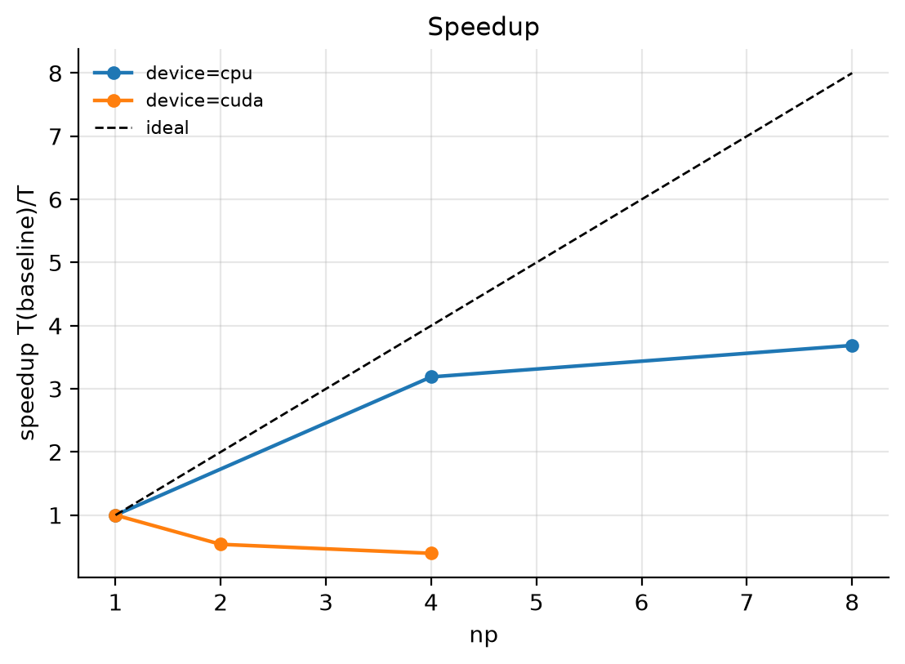
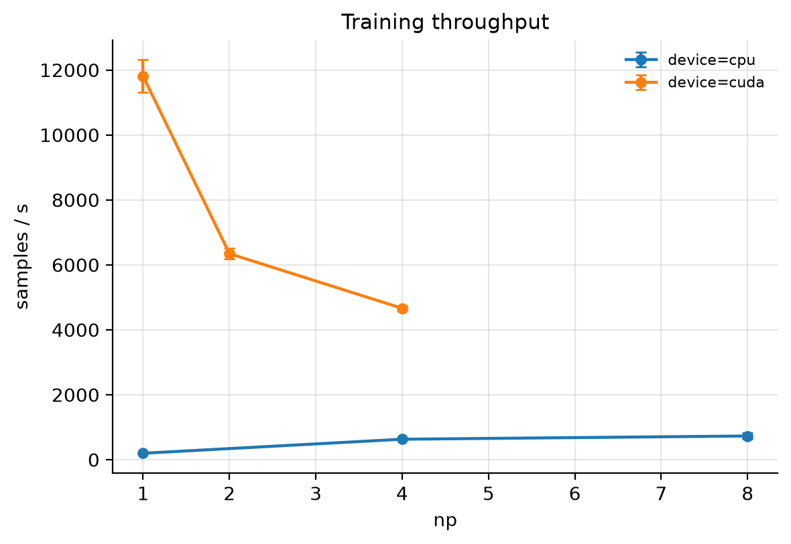
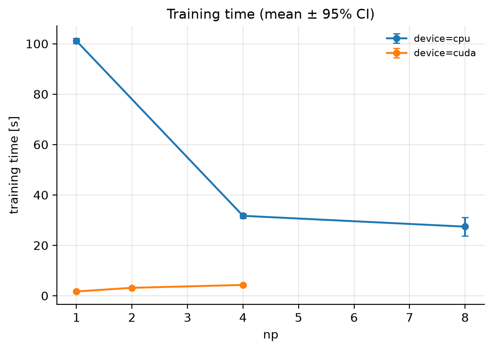

# pdl-bench report

Generated 2026-11-23T01:05:27 from 1 run directory. CSV and LaTeX tables are in each run's `analysis/` folder, figures (PNG + PDF) in `figures/`.

## Experiment `gpu_mpi`

Run directory: `../experiments/results/dot2_e7_gpu_mpi/20261123-005610`

Synchronous SGD on CIFAR-10 (cnn width 4, 20k samples, 1 epoch, global batch 256): CUDA ranks sharing one GPU (np 1, 2, 4) vs CPU ranks (np 1, 4, 8).

Runs: ok: 18

### Key findings

- Best speedup **3.69×** at device=cpu, np=8 (efficiency 0.461).
- At the largest process count (p=8) parallel efficiency ranges 0.46–0.46.
- Communication + synchronization share of training time: p=1: 0.0%, p=2: 26.0%, p=4: 23.7%, p=8: 21.7%.
- Maximum load imbalance (max/mean compute): 1.05.
- Highest final test accuracy **48.02%** with device=cuda, np=4 in 4.3s.
- Fastest to 47.0% test accuracy: device=cuda, np=1 (1.7s).

### Training summary

| device | np | n_runs | train_time_s_mean | train_time_s_ci95 | throughput_samples_per_s_mean | speedup | efficiency | comm_fraction_mean | load_imbalance_mean | final_test_acc_mean |
|---|---|---|---|---|---|---|---|---|---|---|
| cpu | 1 | 3 | 101.1 | 0.9611 | 197.5 | 1 | 1 | 0 | 1 | 0.475 |
| cpu | 4 | 3 | 31.71 | 0.9929 | 629.9 | 3.188 | 0.7971 | 0.04723 | 1.006 | 0.4798 |
| cpu | 8 | 3 | 27.42 | 3.705 | 729.7 | 3.687 | 0.4609 | 0.2166 | 1.046 | 0.4793 |
| cuda | 1 | 3 | 1.691 | 0.07243 | 1.181e+04 | 1 | 1 | 0 | 1 | 0.4772 |
| cuda | 2 | 3 | 3.148 | 0.0793 | 6343 | 0.5372 | 0.2686 | 0.2598 | 1.001 | 0.4782 |
| cuda | 4 | 3 | 4.285 | 0.07565 | 4660 | 0.3947 | 0.09868 | 0.427 | 1.002 | 0.4802 |

### Phase breakdown (seconds, mean over ranks)

| device | np | phase_mean_data_mean | phase_mean_h2d_mean | phase_mean_forward_mean | phase_mean_backward_mean | phase_mean_transfer_mean | phase_mean_sync_wait_mean | phase_mean_comm_mean | phase_mean_update_mean | phase_mean_eval_mean | phase_mean_shuffle_mean |
|---|---|---|---|---|---|---|---|---|---|---|---|
| cpu | 1 | 0.02199 | 0.01855 | 36.37 | 64.45 | 0 | 0 | 0 | 0.2373 | 3.669 | 0 |
| cpu | 4 | 0.01343 | 0.007092 | 10.67 | 18.43 | 0 | 0.4881 | 1.011 | 1.089 | 1.041 | 0 |
| cpu | 8 | 0.01188 | 0.005159 | 7.478 | 11.7 | 0 | 3.661 | 2.297 | 2.258 | 0.7186 | 0 |
| cuda | 1 | 0.01963 | 0.02574 | 0.4031 | 1.217 | 0 | 0 | 0 | 0.02532 | 0.04444 | 0 |
| cuda | 2 | 0.009776 | 0.01769 | 0.5958 | 1.632 | 0.4138 | 0.02077 | 0.3832 | 0.07482 | 0.06148 | 0 |
| cuda | 4 | 0.005096 | 0.01703 | 0.6199 | 1.684 | 0.773 | 0.05758 | 0.9987 | 0.1281 | 0.06453 | 0 |

### Time to accuracy

| config | target | epoch | time_to_target_s |
|---|---|---|---|
| device=cpu, np=1 | 0.4703 | 1 | 101.1 |
| device=cpu, np=4 | 0.4703 | 1 | 31.71 |
| device=cpu, np=8 | 0.4703 | 1 | 27.42 |
| device=cuda, np=1 | 0.4703 | 1 | 1.691 |
| device=cuda, np=2 | 0.4703 | 1 | 3.148 |
| device=cuda, np=4 | 0.4703 | 1 | 4.285 |

### Performance model

- Single-node runs: MPI uses shared memory, so α/β describe intra-node copies and the model ignores memory-bandwidth contention between ranks.

### Figures

### Environment

| Item | Value |
|---|---|
| Host | TuanNguyen |
| OS | Linux 5.15.146.1-microsoft-standard-WSL2 x86_64 |
| CPU | 12th Gen Intel(R) Core(TM) i5-12600K |
| Physical cores | 8 |
| Logical CPUs | 16 |
| Memory | 7.6 GiB |
| GPU | GPU 0: NVIDIA GeForce RTX 2060 (UUID: GPU-32e2fcd7-f21c-bdc3-c469-19441f361371) |
| Compiler | gcc (Ubuntu 13.3.0-6ubuntu2~24.04.1) 13.3.0 |
| CUDA | Build cuda_12.0.r12.0/compiler.32267302_0 |
| MPI | mpirun (Open MPI) 4.1.6 |
| CMake | cmake version 3.28.3 |
| Python | 3.12.3 |
| Git commit | `3e73d8f802d0` (dirty) |
| GPU (binary) | NVIDIA GeForce RTX 2060 |
