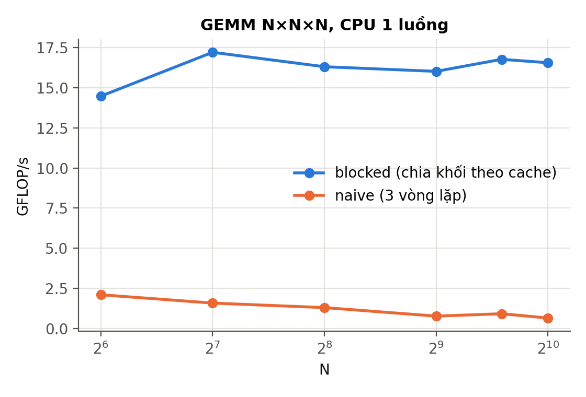
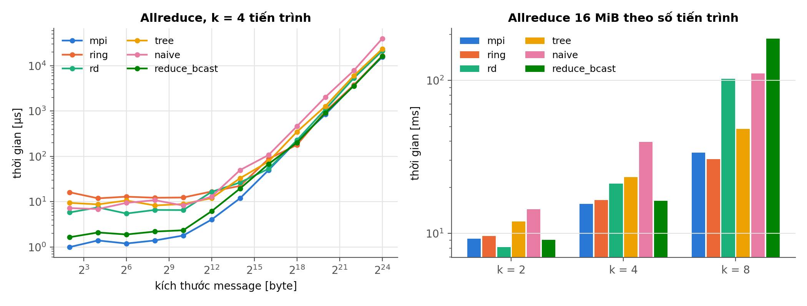
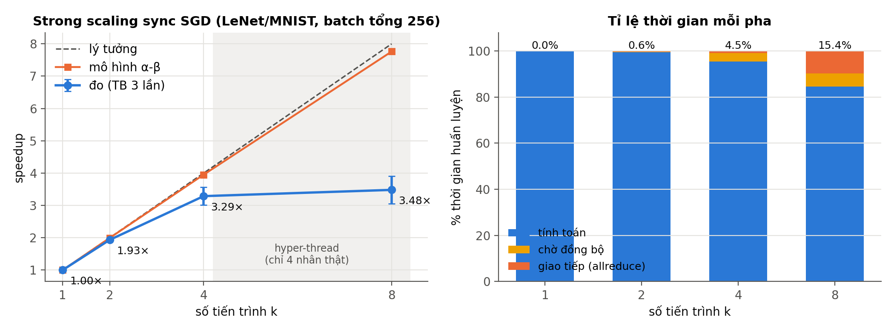
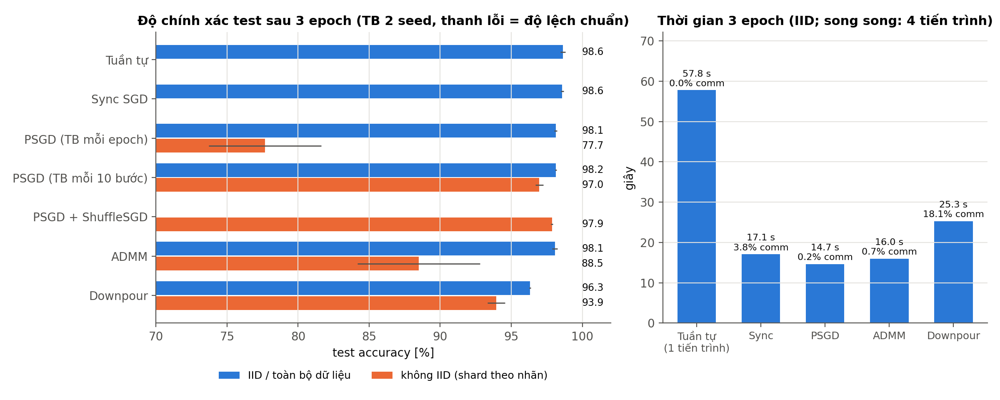

# Báo cáo: Huấn luyện CNN song song và phân tán — cài đặt từ đầu bằng C / MPI / OpenMP / CUDA

**Tác giả**: Tuan Nguyen (thư mục `tuannn/`, Nhóm 10)
**Bài báo tham chiếu**: V. Hegde, S. Usmani, *Parallel and Distributed Deep Learning*, Stanford
University, 2016 — [hgpu.org/?p=16046](https://hgpu.org/?p=16046)
**Ngày**: 22/11/2026 · **Phiên bản mã nguồn**: pdl-bench 1.0.0 (`tuannn/code/`)

---

## Tóm tắt

Báo cáo trình bày một hệ thống huấn luyện mạng nơ-ron tích chập (CNN) được cài đặt hoàn toàn bằng C,
không dùng framework, gồm hai phiên bản. **Phiên bản tuần tự** là một chương trình C một luồng.
**Phiên bản song song** dùng MPI cho song song dữ liệu, OpenMP cho đa luồng trên CPU và CUDA cho GPU.
Phiên bản song song có bốn phương pháp tối ưu phân tán được bài báo phân tích: Synchronous SGD,
Parallel SGD (kèm ShuffleSGD), ADMM và Downpour SGD, cùng sáu thuật toán allreduce tự viết. Đợt thực
nghiệm thứ nhất chạy trên CPU 4 nhân (i5-8257U) và cho thấy:

1. Hai phiên bản cho kết quả **giống hệt** khi cùng cấu hình. Sync SGD trên k tiến trình lệch với
   tuần tự dưới 6·10⁻⁸.
2. Thời gian của lớp conv trong bài **tuyến tính theo batch** (5,78 ms/ảnh, R² = 0,9987), đúng dạng
   O(n) mà bài mô tả cho CPU. im2col + GEMM nhanh hơn conv trực tiếp 12–15×.
3. Sync SGD đạt speedup **3,29× trên 4 nhân** với độ chính xác không đổi (≈ 98%). Giới hạn scale nằm
   ở phần tính toán dùng chung tài nguyên, không phải giao tiếp (allreduce chỉ chiếm 1% thời gian).
4. Trên một node, ring allreduce và `MPI_Allreduce` nhanh hơn allreduce dạng cây mà bài đề xuất.
5. Khi dữ liệu không IID, Parallel SGD chỉ lấy trung bình mỗi epoch rơi từ 98,1% xuống **77,7%**.
   ShuffleSGD đưa về 97,9%, và lấy trung bình mỗi 10 bước cũng đưa về 97,0%.

Phần GPU đã được cài đặt và kiểm tra biên dịch nhưng chưa chạy trên GPU. Phép đo GPU thuộc đợt 2 trên
máy i5-12600K + RTX 2060.

---

## 1. Giới thiệu

Huấn luyện mạng sâu tốn nhiều giờ đến nhiều ngày trên một CPU. Bài của Hegde và Usmani đặt hai câu
hỏi: (i) tăng tốc được bao nhiêu nhờ GPU và đa nhân (§3), và (ii) nên cập nhật trọng số thế nào khi
dữ liệu chia trên nhiều máy (§5). Bài đo §3 bằng Caffe và chỉ phân tích lý thuyết §5 (bậc O(·) của
thời gian tính, chi phí và thời gian truyền thông).

Phần việc này **cài đặt lại toàn bộ từ đầu** để có thể:

- đo trực tiếp từng pha của một bước huấn luyện (nạp dữ liệu, forward, backward, chờ đồng bộ,
  giao tiếp, cập nhật), điều mà framework thường che khuất;
- thay đổi thuật toán allreduce và so với mô hình chi phí α-β;
- cài đủ bốn phương pháp ở §5 trên **cùng một** mã nguồn, để so sánh công bằng;
- chứng minh bằng kiểm thử rằng bản song song tính đúng như bản tuần tự.

Phần này bổ sung cho `vinhvn/`, vốn tái lập cùng bài bằng PyTorch trên 4× H100.

## 2. Câu hỏi nghiên cứu

| # | Câu hỏi | Thí nghiệm |
|---|---|---|
| Q1 | Bản song song có cho đúng kết quả như bản tuần tự không? | E0 |
| Q2 | Khẳng định §3 (thời gian conv tuyến tính theo batch, cách cài conv) có đúng trên CPU hiện đại không? | E1, E2 |
| Q3 | Thuật toán allreduce nào tốt nhất theo kích thước message và số tiến trình? Mô hình chi phí có khớp không? | E3 |
| Q4 | Sync SGD scale đến đâu? Giao tiếp chiếm bao nhiêu? | E4 |
| Q5 | Bốn phương pháp ở §5 đánh đổi gì về thời gian, giao tiếp và độ chính xác, với dữ liệu IID và không IID? | E5 |
| Q6 | GPU nhanh hơn CPU bao nhiêu (bài: ≈ 40×)? | Đợt 2 (chưa chạy) |

## 3. Thiết kế và cài đặt

### 3.1 Lõi CNN dùng chung (C11)

| Thành phần | Cài đặt |
|---|---|
| Lớp | convolution, fully-connected, ReLU, max-pooling; hàm mất mát softmax cross-entropy (công thức (2) của bài) |
| Convolution | im2col + GEMM theo đúng cách Caffe mà bài phân tích ở §3.1: mỗi ảnh được "trải" thành ma trận K × P (K = C·k·k, P = OH·OW), rồi nhân với ma trận trọng số OC × K. Backward: dW = Σ dY·colᵀ, dcol = Wᵀ·dY, rồi col2im |
| Tối ưu | SGD có momentum và weight decay; khởi tạo He |
| Tham số | **một mảng phẳng** cho toàn bộ tham số và một mảng cho gradient, nên đồng bộ gradient chỉ là một lệnh allreduce trên một vùng nhớ liên tục |
| Mô hình | LeNet (MNIST, 61 706 tham số), cấu hình của bài (224×224, 96 bộ lọc 11×11/4, 40 lớp), CNN có hệ số độ rộng để quét kích thước mô hình |
| Dữ liệu | MNIST, CIFAR-10 (định dạng `.pdlds`), dữ liệu tổng hợp sinh theo (seed, chỉ số mẫu) |
| Ngẫu nhiên | xoshiro256** với seed tách theo (seed, rank, epoch), nên một thí nghiệm tái lập được từng bit |

### 3.2 Phiên bản tuần tự — `code/sequential/seq_train.c`

Một chương trình C một luồng (khoảng 300 dòng) chỉ dùng lõi chung và kernel CPU. Biên dịch bằng
`gcc` + `Makefile`, **không cần MPI, OpenMP hay CUDA**. Thứ tự mẫu, khởi tạo và luật cập nhật giống
hệt nhánh tuần tự của bản song song, nên đây là đường cơ sở cho mọi phép đo speedup và để kiểm tra
tính đúng.

### 3.3 Phiên bản song song — `code/`

**a) Song song dữ liệu bằng MPI** (`src/train/`). Mỗi tiến trình giữ một bản sao mô hình và một phần
dữ liệu. Bốn chiến lược của bài:

| Chiến lược | Thuật toán | Giao tiếp |
|---|---|---|
| Sync SGD (§5.1) | Mỗi rank tính gradient trên phần của batch tổng; allreduce gradient rồi chia k, cập nhật như nhau | 1 allreduce p số thực mỗi bước; có các biến thể: gộp một lần, mỗi lớp một lần, chồng lấp với backward |
| Parallel SGD (§5.1.1, Zinkevich) | Mỗi worker chạy SGD riêng trên shard của mình; lấy trung bình mô hình mỗi H bước, mỗi epoch, hoặc chỉ một lần ở cuối. **ShuffleSGD**: sau mỗi epoch, all-to-all chuyển 1/k shard tới từng worker | 1 allreduce mỗi lần lấy trung bình; all-to-all dữ liệu O(D) |
| ADMM (§5.1.2) | Consensus ADMM (Boyd 2011): x_i giải xấp xỉ bằng L bước SGD với hạng phạt ρ/2‖x − z + u_i‖²; z = trung bình(x_i + u_i); u_i += x_i − z | 1 allreduce mỗi vòng (L bước) |
| Downpour SGD (§5.2) | Rank 0 là parameter server; worker đẩy gradient tích lũy mỗi n_push bước và lấy tham số mỗi n_fetch bước, đều không chặn (Isend/Irecv); đo staleness | điểm-điểm worker ↔ server |

*Ghi chú*: Algorithm 3 trong bài (ADMM.SGD) thực chất là parameter server đồng bộ, không có biến đối
ngẫu. Ở đây cài consensus ADMM đúng nghĩa. Mẫu giao tiếp "server đồng bộ" của bài đo được bằng sync
SGD với allreduce `naive`.

**b) Sáu thuật toán allreduce** (`src/comm/comm.c`), tự viết trên giao tiếp điểm-điểm để so với mô
hình chi phí:

| Thuật toán | Thời gian theo mô hình Hockney (α độ trễ, β giây/byte, n byte) |
|---|---|
| ring (reduce-scatter + allgather) | 2(k−1)α + 2(k−1)/k · nβ |
| recursive doubling | log₂k · (α + nβ) |
| tree: binomial reduce + broadcast ("BitTorrent aggregate" của bài) | 2·log₂k · (α + nβ) |
| naive: driver trung tâm (dạng parameter server) | 2(k−1)(α + nβ) |
| `MPI_Reduce` + `MPI_Bcast`, `MPI_Allreduce` | hàm thư viện |

Mọi thuật toán cho kết quả **trùng từng bit** trên mọi rank. Nhờ đó có thể kiểm tra các bản sao mô
hình bằng hash trong khi huấn luyện.

**c) Đa luồng OpenMP** (`src/backend/cpu_kernels.c`): GEMM chia khối theo cache, chia hàng của C cho
các luồng; im2col và các phép theo phần tử song song theo ảnh trong batch. Đây là hai cách dùng
nhiều nhân mà bài nêu ở §2.

**d) GPU bằng CUDA** (`src/backend/cuda_kernels.cu`, sm_75): GEMM naive, GEMM chia tile bằng shared
memory, cuBLAS; im2col/col2im, pooling, softmax. Backward của col2im và max-pool dùng dạng "gom"
(không dùng atomics) nên kết quả tất định. MPI chạy trên bản sao tham số ở host (không đòi hỏi
CUDA-aware MPI). Pha chép device ↔ host được đo riêng.

### 3.4 Đo đạc và kiểm tra tính đúng

- Mỗi bước được chia thành 10 pha có đồng hồ riêng trên mỗi rank: `data, h2d, forward, backward,
  transfer, sync_wait, comm, update, eval, shuffle`. `sync_wait` là thời gian chờ ở barrier ngay
  trước allreduce, tức là chi phí của chênh tải.
- Thời gian huấn luyện không tính lúc đánh giá. Một phép toán tập thể được tính theo rank chậm nhất.
- `pdl_check` kiểm tra: gradient bằng sai phân hữu hạn (bỏ qua các điểm rơi vào chỗ gãy của
  ReLU/max-pool), các biến thể GEMM, kernel CUDA so với CPU, tính tất định, allreduce đúng tổng,
  **sync SGD trên k tiến trình bằng tuần tự**, và replica trùng từng bit.
- Mỗi file kết quả JSON ghi đủ cấu hình và môi trường (CPU, trình biên dịch, thư viện MPI, commit).

## 4. Phương pháp thực nghiệm

| | Đợt 1 (đã chạy) |
|---|---|
| Phần cứng | Intel Core i5-8257U, 4 nhân / 8 luồng, 16 GB; không GPU |
| Phần mềm | macOS 13.7, Apple Clang 14 (không OpenMP), MPICH 5.0.2, `-O3 -march=native` |
| Dữ liệu | MNIST 60k/10k; E2 dùng hình học ảnh 224×224 của bài |
| Lặp | E1–E3: 5–20 lần đo cho mỗi điểm; E4: 3 lần chạy; E5: 2 seed |
| Quy trình | Dự đoán được ghi vào `experiments/PLAN.md` **trước khi chạy**. Cấu hình YAML ở `experiments/configs/`. Số đo gốc ở `experiments/results/` |

## 5. Kết quả

### 5.1 Tính đúng (Q1)

| Kiểm tra | Kết quả |
|---|---|
| Gradient giải tích so với sai phân hữu hạn (4 mạng, 277 tham số) | sai số tương đối ≤ 1,1·10⁻⁴ |
| Sync SGD k = 2 / k = 4 so với tuần tự cùng batch tổng | lệch tham số 5,7·10⁻⁸ / 2,9·10⁻⁸ |
| Replica sau 6 thuật toán allreduce | trùng từng bit |
| `seq_train` so với `pdl_train --strategy sequential` | loss và accuracy giống hệt ở mọi epoch |
| CTest (12 bài, gồm chạy thử cả 5 chiến lược) | 12/12 đạt |

Bản song song **tính đúng như bản tuần tự**. Sai lệch duy nhất là thứ tự cộng số thực.

### 5.2 Tính toán: GEMM và lớp conv của bài (Q2)


*Hình 1. Lớp conv đầu của bài (96 bộ lọc 11×11, stride 4, ảnh 224×224) trên một nhân CPU. Trái:
thời gian tuyến tính theo batch. Phải: conv trực tiếp chậm hơn im2col + GEMM bao nhiêu lần.*

- Thời gian **tuyến tính theo batch**: 5,78 ms/ảnh, R² = 0,9987, đúng dạng O(n) bài mô tả. Bài
  báo cáo độ dốc 6,45 cho đường CPU (Xeon E5-2670, Caffe) nhưng phần văn bản không ghi đơn vị. Nếu
  đơn vị là ms/ảnh thì hai kết quả cùng bậc, nhưng không nên so sánh trực tiếp hai con số.
- im2col + GEMM nhanh hơn conv trực tiếp **12,4–15,5×**. Lý do chính là GEMM dùng lại dữ liệu trong
  cache, không phải số phép tính (hai cách có cùng số FLOP).



*Hình 2. GEMM N×N×N một luồng: cài đặt chia khối theo cache so với ba vòng lặp lồng nhau.*

- GEMM chia khối giữ 14,5–17,2 GFLOP/s ở mọi N; bản naive tụt từ 2,1 xuống 0,65 GFLOP/s, tức
  chậm hơn **tới 25×** khi N = 1024. Dự đoán ban đầu (3–10×) đã đánh giá thấp tác động của cache.
- Lớp FC (nhân ma trận–vector) tăng đúng O(n²), trừ một bước nhảy khi ma trận trọng số (16 MB)
  vượt bộ nhớ L3 (6 MB).

### 5.3 Giao tiếp: sáu thuật toán allreduce (Q3)



*Hình 3. Trái: thời gian allreduce theo kích thước message với k = 4 (log–log). Phải: allreduce
16 MiB theo số tiến trình.*

- Đo bằng ping-pong: α = 2,66 µs, băng thông 3,4 GB/s (MPI qua shared memory).
- **Message nhỏ** (≤ 4 KiB): hàm thư viện (`MPI_Allreduce` 1,0 µs) nhanh hơn mọi bản tự viết 5–16×.
  Trong các bản tự viết, recursive doubling và tree (log k vòng) thắng ring (2(k−1) vòng), đúng
  như mô hình.
- **Message lớn** (16 MiB): ring ≈ `MPI_Allreduce` < recursive doubling < tree < naive. Naive tăng
  gần tuyến tính theo k (14 → 40 → 111 ms), xác nhận driver trung tâm là nút thắt (bài §5.2).
  Allreduce dạng cây, mà bài dùng để phân tích, **không** phải lựa chọn tốt khi gradient lớn: cây gửi
  cả vector ở mỗi tầng, còn ring chỉ gửi 2(k−1)/k của vector.
- Mô hình α-β dự đoán allreduce lớn sai trung vị 14% với ring và 22% với `MPI_Allreduce`, nhưng
  50–165% với các thuật toán dồn việc về một rank. Khi k = 8 vượt số nhân thật, vài thuật toán chậm
  đi 5–10× do hai tiến trình tranh một nhân.

### 5.4 Strong scaling của Sync SGD (Q4)



*Hình 4. Trái: speedup đo được (trung bình 3 lần, thanh lỗi là độ lệch chuẩn) so với lý tưởng và
với mô hình α-β. Phải: tỉ lệ thời gian của tính toán, chờ đồng bộ và allreduce.*

| k | thời gian 1 epoch | speedup | hiệu suất | chờ + giao tiếp | test acc |
|---|---|---|---|---|---|
| 1 | 19,20 s | 1,00 | 100% | 0% | 97,97% |
| 2 | 9,93 s | 1,93 | 97% | 0,6% | 97,86% |
| 4 | 5,84 s | 3,29 | 82% | 4,4% | 97,89% |
| 8 (hyper-thread) | 5,52 s | 3,48 | 44% | 14,8% | 98,04% |

- Speedup 3,29× trên 4 nhân với cùng độ chính xác.
- Mô hình α-β (tính toán chia đều cho k cộng với allreduce 247 KB) dự đoán 3,95×. Phần thiếu
  **không phải do giao tiếp**: allreduce chỉ mất 0,05 s mỗi epoch. Thời gian forward + backward ở
  k = 4 tăng 15% so với lý tưởng, vì 4 nhân cùng chạy làm giảm turbo và phải chia băng thông bộ nhớ.
  Thời gian chờ đồng bộ (0,21 s) lớn gấp 4 lần allreduce, do dao động từng bước giữa các rank.
- Với k = 8, hai tiến trình chung một nhân nên gần như không nhanh thêm (3,48×).

### 5.5 Bốn phương pháp tối ưu phân tán (Q5)



*Hình 5. Trái: độ chính xác test sau 3 epoch với dữ liệu IID (xanh) và không IID, tức shard sắp theo
nhãn (cam). Phải: thời gian huấn luyện và tỉ lệ giao tiếp.*

| Phương pháp (4 tiến trình) | IID | Không IID | Thời gian | Speedup | Byte gửi / rank |
|---|---|---|---|---|---|
| Tuần tự (1 tiến trình) | 98,64% | — | 57,8 s | 1,00× | 0 |
| Sync SGD | 98,58% | — | 17,1 s | 3,38× | 260 MB |
| PSGD, trung bình mỗi epoch | 98,12% | **77,68%** | 14,7 s | 3,94× | 1,1 MB |
| PSGD + ShuffleSGD | — | **97,87%** | 17,1 s | — | 18,8 MB |
| PSGD, trung bình mỗi 10 bước | 98,15% | 96,98% | 15,4 s | 3,75× | 26,7 MB |
| ADMM (20 bước/vòng) | 98,06% | 88,48% | 16,0 s | 3,61× | 13,3 MB |
| Downpour (3 worker + server) | 96,32% | 93,94% | 25,3 s | 2,29× | 115,5 MB |

Nhận xét:

1. **Sync SGD** cho đúng độ chính xác của tuần tự (khác 0,06 điểm) và nhanh hơn 3,4×. Đây là lựa
   chọn an toàn nhất, nhưng tốn băng thông nhất (260 MB mỗi rank).
2. **Parallel SGD** giao tiếp ít nhất (1,1 MB) và nhanh nhất (3,94×) **khi dữ liệu IID**. Giả thiết
   "mỗi máy có một mẫu đại diện" của bài là then chốt: khi shard sắp theo nhãn, độ chính xác rơi
   20 điểm. Hai cách khắc phục đều hiệu quả. ShuffleSGD, như bài đề xuất, cho 97,9% nhưng phải
   chuyển dữ liệu. Lấy trung bình thường xuyên hơn cho 97,0% mà không phải di chuyển dữ liệu.
3. **ADMM** ngang PSGD khi IID. Khi không IID, biến đối ngẫu giúp nó hơn PSGD-mỗi-epoch (88,5% so
   với 77,7%), nhưng kém PSGD-mỗi-10-bước (97,0%), phương pháp chỉ tốn gấp đôi lượng giao tiếp (26,7 so với 13,3 MB).
4. **Downpour** chậm nhất trong các phương pháp song song: một server phục vụ 3 worker, giao tiếp
   chiếm 18%. Độ chính xác thấp nhất khi IID vì gradient bị trễ trung bình 11 phiên bản (staleness).
   Bài cảnh báo đúng điều này ở §5.2.1: thông lượng bị chặn bởi server. Muốn thấy điểm bão hòa
   k* = T/τ cần nhiều worker hơn (đợt 2).

## 6. Thảo luận: đối chiếu với bài báo

| Khẳng định của bài | Kết quả ở đây |
|---|---|
| §3: thời gian conv trên CPU tuyến tính theo batch (O(n)) | **Khẳng định** (R² = 0,9987; độ dốc 5,78 ms/ảnh) |
| §3.1: im2col + GEMM là cách hiệu quả, GEMM chiếm phần lớn thời gian | **Khẳng định** (nhanh hơn conv trực tiếp 12–15×) |
| §3: GPU nhanh hơn CPU ≈ 40×, càng nhanh khi batch càng lớn | **Chưa kiểm chứng** (cần GPU, đợt 2) |
| §5: allreduce kiểu cây ("BitTorrent aggregate"), O(p log k) | Đúng về dạng, nhưng trên một node **ring nhanh hơn cây** với gradient lớn |
| §5.1.1: Parallel SGD cần dữ liệu trộn đều; ShuffleSGD khắc phục | **Khẳng định** (77,7% → 97,9%); bổ sung: trung bình thường xuyên cũng khắc phục được |
| §5.1.2: ADMM tránh được việc trộn dữ liệu | **Một phần**: tốt hơn PSGD-mỗi-epoch khi không IID, nhưng chưa bằng trộn dữ liệu |
| §5.2.1: Downpour bị giới hạn bởi server | **Khẳng định ở quy mô nhỏ**: comm 18%, chậm nhất; chưa đo điểm bão hòa |

## 7. Giới hạn

- Chưa có số đo GPU và OpenMP: máy đợt 1 không có GPU, và Apple Clang không hỗ trợ OpenMP. Mã CUDA
  mới được kiểm tra biên dịch (clang CUDA cho sm_75, 0 cảnh báo), chưa chạy.
- Mọi phép đo đều trên **một máy**. MPI đi qua shared memory, nên "băng thông mạng" trong mô hình là
  băng thông bộ nhớ. Không suy ra được hành vi giữa nhiều máy.
- Mô hình nhỏ (LeNet, 247 KB gradient) làm giao tiếp rẻ. Với mô hình lớn, tỉ lệ giao tiếp sẽ khác
  (cấu hình `model_scaling.yaml` dành cho đợt 2).
- Số lần lặp còn ít (3 lần ở E4, 2 seed ở E5). Độ lệch chuẩn ở E5 với dữ liệu không IID là ± 4
  điểm, nên các chênh lệch nhỏ hơn vài điểm chưa có ý nghĩa thống kê.
- Siêu tham số (learning rate, ρ, n_push) chọn một lần, chưa tinh chỉnh cho từng phương pháp, nên so
  sánh độ chính xác là so sánh "cấu hình mặc định hợp lý", không phải tốt nhất của mỗi phương pháp.

## 8. Hướng tiếp theo (đợt 2, máy i5-12600K + RTX 2060)

1. Chạy `ctest` và `pdl_check --device both` để kiểm chứng phần CUDA lần đầu.
2. Đo §3 đầy đủ có GPU (`compute_paper_cpu_gpu.yaml`) để kiểm tra con số ≈ 40×.
3. Strong scaling đến 10 nhân với P-core và E-core (`strong_scaling.yaml`), MPI + OpenMP
   (`hybrid_mpi_omp.yaml`), nhiều tiến trình dùng chung GPU (`gpu_mpi.yaml`).
4. Tăng số seed cho E5 và thêm Downpour với nhiều worker để tìm điểm bão hòa k* = T/τ.

## 9. Tái lập

Xem [`../README.md`](../README.md), mục "Cách chạy lại". Tóm tắt:

```bash
cd tuannn/code/sequential && make && ./seq_train --epochs 3          # bản tuần tự
cd tuannn/code && scripts/build.sh && ctest --test-dir build          # bản song song + kiểm tra
for e in e0_correctness e1_gemm e2_paper_cpu e3_comm e4_strong_scaling e5_strategies; do
  pdlbench all ../experiments/configs/dot1_$e.yaml --results-dir ../experiments/results; done
python ../report/make_figures.py                                       # vẽ lại hình của báo cáo
```

## Tài liệu tham khảo

1. V. Hegde, S. Usmani. *Parallel and Distributed Deep Learning*. Stanford University, 2016.
2. M. Zinkevich, M. Weimer, A. Smola, L. Li. *Parallelized Stochastic Gradient Descent*. NIPS 2010.
3. S. Boyd, N. Parikh, E. Chu, B. Peleato, J. Eckstein. *Distributed Optimization and Statistical
   Learning via the Alternating Direction Method of Multipliers*. Foundations and Trends in ML, 2011.
4. J. Dean et al. *Large Scale Distributed Deep Networks*. NIPS 2012.
5. Y. Jia et al. *Caffe: Convolutional Architecture for Fast Feature Embedding*. 2014.
6. R. Thakur, R. Rabenseifner, W. Gropp. *Optimization of Collective Communication Operations in
   MPICH*. IJHPCA, 2005.
